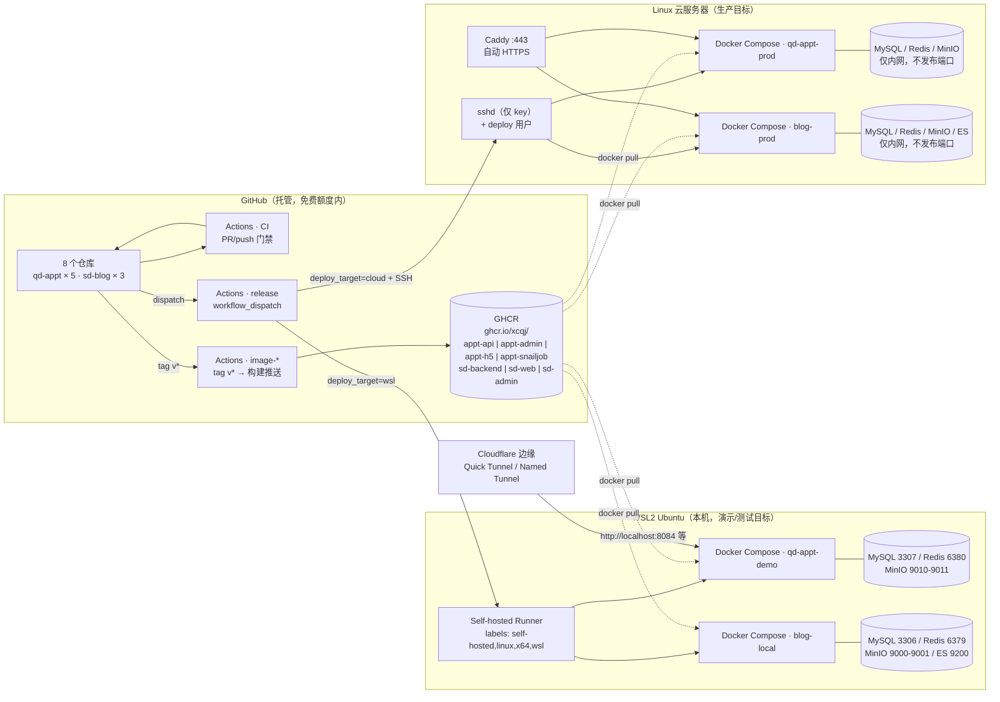
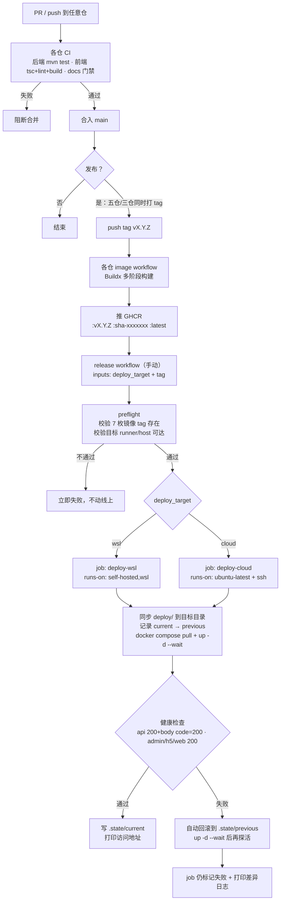
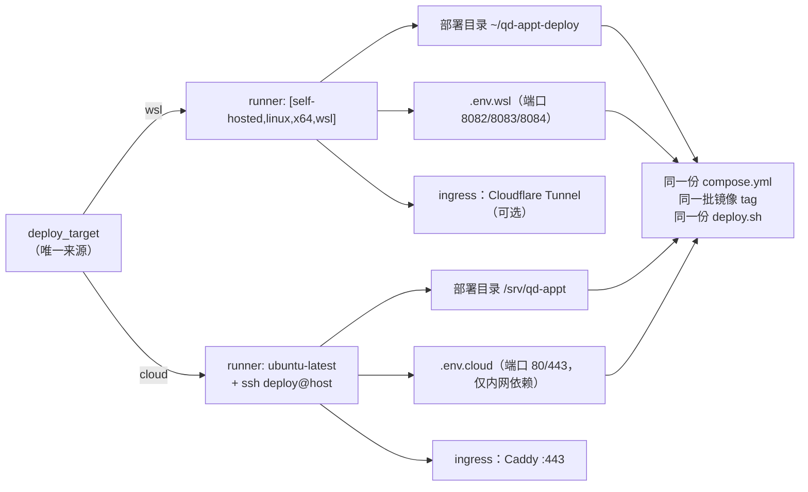

# 部署与 CI/CD 方案（qd-appt · sd-blog）

> **性质**：方案文档，**只写「怎么做」**。切片做什么、做到哪、什么算完成，一律以 `ROADMAP.md` 为准——**本文不记进度、不打勾选框**（2026-10-29 定）。
> **范围**：主线只覆盖 **qd-appt**；sd-blog 见 **附录 C**（2026-10-29 定：两项目目录结构不同，不并行做）。
> **生成日期**：2026-10-29 ｜ **最近更新**：2026-10-29 第二轮（补入实机联调结论 §2.7 / 踩坑 §2.8 / 隧道实操 §9.6 / 新增风险 R15–R18）
> **核查基线**（各仓 `git log --oneline -1`，均为本次实测）：
> `qd-appt-backend` d2d98ab · `qd-appt-admin` 03b0399 · `qd-appt-app` 6e719f3 · `qd-appt-showcase` 4de6291 · `qd-appt-docs` f2d4cfc ·
> `ryblogs` e9769c963 · `ryblogs-ui` b6bea12 · `blogs-web` 76a016f
> **工作区未提交改动**（与本方案无关，仅记录基线）：`qd-appt/app` `M src/manifest.json`（小程序 appid）· `qd-appt/docs` `M appt.code-workspace` + 未跟踪的本方案提示词 · `ryblogs` `M docs/ROADMAP.md`
> **路径约定**：文中路径若以 `showcase/`、`backend/` 开头，指 `qd-appt/` 下的同级仓；以 `RuoYi-Vue-Plus/`、`blog-web/`、`plus-ui/` 开头，指 `sd-blog/` 下的同级仓。

---

## 0. 结论先读（推荐方案）

| 问题 | 结论 |
|---|---|
| 编排工具 | **GitHub Actions**（两项目都已在用 CI，扩到 CD 的成本最低；当前规模无任何理由上 Jenkins） |
| 构建产物 | Java：Maven `-Pprod` 打 jar → **多阶段 Dockerfile**（两边都已具备）；前端：pnpm/npm → nginx 静态（两边都已具备） |
| 镜像仓库 | **GHCR `ghcr.io/xcqj/*`**（qd-appt 已在用四个；sd-blog 需新增三个）。**建议设为 public**：容器镜像目前不计存储与带宽费，且可匿名拉取，部署机不需要长期 registry 凭据 |
| 发布标识 | **一个 release tag `vX.Y.Z` 同时打到该项目的全部仓**，Compose 只认 `${TAG}`；`sha-<短SHA>` 作为不可变追溯标签；**部署禁止用 `latest`** |
| 目标切换唯一来源 | **`deploy_target` 这一个变量**。CI 里由 `workflow_dispatch` 下拉赋值，本地由 `./deploy.sh <wsl\|cloud>` 的位置参数赋值——两者写的是同一个变量，不允许出现第二个开关 |
| WSL 自动部署 | 仓库级 **Self-hosted Runner**（标签 `wsl`），**只允许手动 `workflow_dispatch` 触发**，不接 PR |
| 云服务器部署 | **GitHub-hosted Runner + SSH**（服务器不装 Runner），远端执行同一份 `deploy.sh` |
| 外部访问 | **WSL 场景已于 2026-10-29 实跑通过**：Cloudflare **Named Tunnel** + 自有域名（需域名托管到 Cloudflare）。Quick Tunnel 仍可临时演示，但官方明确**不支持 SSE**；云服务器场景推荐 **Caddy 自动 HTTPS** |
| 已完成（2026-10-29 手工，非流水线） | 域名接入 Cloudflare → 隧道 systemd 常驻 → 两域名指向容器（`admin`→18083 / `demo`→18084）→ HTTPS + 验证码 + RSA/AES 登录 → 下单/支付/站内信 → SSE 通道。**细节与踩坑见 §2.7 / §2.8** |
| 现在必须做 | ① qd-appt 的 compose 去 `build:`（拆 base/deps/target 覆盖；**不做这步，"拉同一镜像部署"就是假的**）② 统一 `deploy.sh` + `.state` 回滚 ③ **GHCR 首推**（Q4 至今未推，当前跑的都是本地构建镜像）④ tag 规范 `vX.Y.Z` |
| 可以延后 | sd-blog 全套（附录 C）、Trivy/SonarQube、Prometheus、ES 索引备份、Runner ephemeral 化、多环境（staging） |

---

## 1. 执行摘要

**已经具备的比预想多。** 两个项目都不是"从零开始部署"：

- `qd-appt` 的 S14（2026-10-25 完成）已经交付了四枚镜像（api / snailjob / admin / h5）、`application-docker.yml` 全环境变量化、镜像级 `HEALTHCHECK`、`showcase/demo.sh` 八步编排（含端口自动避让与失败提示）、四份 `.env.example` 和三个 `image*.yml`（tag `v*` 触发推 GHCR）。本地实测镜像体积（ROADMAP §3 证据）：api 793MB / snailjob 638MB / admin 109MB / h5 95.1MB。
- `sd-blog` 的 S25（2026-10-28 交付）已经交付三枚镜像 Dockerfile、七服务 `script/docker/docker-compose.yml`（mysql / redis / minio / 自建 IK 的 ES / backend / web / admin + seed profile）与一套 healthcheck。

**缺的是一条"从 tag 到目标环境"的链，以及为这条链准备的两件事：**

1. **compose 还不能"只拉镜像部署"**：`showcase/deploy/docker-compose.yml` 的四个应用服务都带 `build:` 且 build context 跨仓（`../../backend`、`../../admin`、`../../app`），并用 `include` 复用 `backend/deploy/docker-compose.yml`；`sd-blog` 的 compose 同样带 `build:`（连 ES 都是 `build: ./es`）。**部署机上不应该有源码**，否则"构建一次、发布同一版本"这条原则自动失效。
2. **sd-blog 没有任何镜像推送流水线**（三个仓只有 `ci.yml`），镜像目前只能在本机构建。
3. **两边都没有 CD、没有部署脚本、没有回滚机制、没有备份自动化，也没有任何 ingress（HTTPS/域名）**。qd-appt 的「线上部署」在 ROADMAP 里已拆为 **S16.1**（不依赖服务器，可立即开工）与 **S16.2**（依赖服务器），两片均未开始。

**最大的正确性风险不在流水线，在数据**：两个项目都**没有数据库迁移工具**（无 Flyway/Liquibase）。qd-appt 靠 `backend/deploy/init-db.sh --full` 按序导入 20+ 个 `script/sql/*.sql`；sd-blog 靠 MySQL `docker-entrypoint-initdb.d` 挂载 SQL（**只在数据卷为空时执行一次**）。这意味着：**镜像可以回滚，schema 不能**。方案必须把这一点变成显式流程（§10 R1），而不是假定"回滚就是切回上一个 tag"。

---

## 2. 现状核查

### 2.1 两个项目是什么

| | 项目一 `sd-blog`（Stack Depth） | 项目二 `qd-appt`（号源 QueueDepth） |
|---|---|---|
| 本机目录 | `/home/user01/projects/sd-blog/`（**不是** Git 仓，三仓并列） | `/home/user01/projects/qd-appt/`（不是 Git 仓，五仓并列） |
| 仓库数 | 3：`ryblogs`（后端，分支 `6.X`）/ `ryblogs-ui`（管理端，分支 `6.X-Vue`）/ `blogs-web`（前台，分支 `main`） | 5：`qd-appt-backend` / `-admin` / `-app` / `-showcase` / `-docs`（全 `main`） |
| 有无"部署仓" | 无（部署定义寄居在后端仓 `script/docker/`） | **有**：`showcase`（`demo.sh` + `deploy/`，S13/S14 定位就是门面与一键演示） |
| 后端 | RuoYi-Vue-Plus 单体 Maven，JDK 21，端口 **8081** | 同上游基线 + 自研 `appt` 模块，端口 **8082** |
| 前台 | Nuxt 4 SSR（`node-server` 产物），端口 **3000** | uni-app（H5 产物 + 小程序包），端口 **8084** |
| 管理端 | plus-ui（Vue3 + Vite + pnpm），nginx 80 → 宿主 **8080** | 同 plus-ui，nginx 80 → 宿主 **8083** |
| 依赖 | MySQL / Redis / MinIO / **Elasticsearch 7.17 + IK** | MySQL / Redis / MinIO / **SnailJob 服务端** |
| 镜像现状 | 本地 `docker build`，**无推送流水线** | **GHCR 四枚已有 workflow**（tag `v*`），本地只验证过 build/run |

`/home/user01/projects/open-design`、`/home/user01/projects/dsh-learn` 不属于这两个项目（前者是另一个 Git 仓，后者是空目录），**不在本方案范围内**（Q8）。

### 2.2 `qd-appt` 事实清单（已核查）

**构建 / 运行**

| 项 | 实测值 | 出处 |
|---|---|---|
| JDK / Maven | 21（本地 21.0.12.1 / Maven 3.9.16）；镜像内 `maven:3.9-eclipse-temurin-21` | `backend/Dockerfile` |
| 后端打包命令 | `mvn -B -Pprod -pl ruoyi-admin -am package -DskipTests` | `backend/Dockerfile:21` |
| 后端 CI 命令 | `mvn -B -pl ruoyi-modules/appt -am clean test`（仅 2 个纯逻辑测试类：`SuspendScopeParserTest`、`PiiUtilsTest`，不连库） | `backend/.github/workflows/ci.yml:26` |
| 运行时镜像基底 | `eclipse-temurin:21-jre-jammy`（**不能用 alpine**：musl 下 `libawt` 画验证码会崩，S14 踩过） | `backend/Dockerfile:26` |
| profile | `SPRING_PROFILES_ACTIVE=prod,docker`，`application-docker.yml` 把所有地址类配置改成 `${APPT_*}` 占位 | `backend/Dockerfile:40` / `application-docker.yml` |
| 管理端构建 | `node:22-alpine` + `pnpm@10.34.5` → `nginx:1.31-alpine`；`VITE_APP_BASE_API=/prod-api`（**构建期**） | `admin/Dockerfile:11-29` |
| 管理端反代 | **运行期** `APPT_API_UPSTREAM` 注入 nginx 模板（`NGINX_ENVSUBST_FILTER=^APPT_`） | `admin/docker/nginx/default.conf.template` |
| H5 构建 | `node:22-alpine` + `pnpm@12.4.1` → nginx；`VITE_APP_BASE_API=/dev-api`（**构建期**） | `app/Dockerfile:16-28` |
| Node（本地） | v24.21.0 / pnpm 12.4.1（**与镜像内 Node 22 不同版本**，见 R7） | 本机实测 |
| 前端 CI | admin：`vue-tsc --noEmit` → `oxlint` → `vite build --outDir dist-ci`；app：`type-check` → `lint` → `build:h5` | 两仓 `ci.yml` |
| 文档门禁 | `python3 script/doc_audit.py`（GitHub Actions 亦跑） | `docs/.github/workflows/doc-audit.yml` |

**端口 / 依赖 / 数据**

| 服务 | 容器内 | 宿主（dev / demo） | 备注 |
|---|---|---|---|
| api | 8082 | 8082 | `restart: unless-stopped` + healthcheck `/appt/public/campus/list` |
| admin | 80 | 8083 | healthcheck `wget /` |
| h5 | 80 | 8084 | healthcheck `wget /` |
| snailjob | 8800 / 17888 | 18800 / 27888（demo） | 控制台 context-path `/snail-job` |
| mysql | 3306 | 3307 | `mysql:8.4.9`，**当前开发机未启用**（复用外部 `blog-mysql:3306`） |
| redis | 6379 | 6380 | `redis:8.6.3`，`--appendonly yes`（**已开 AOF**，2026-10-23 起不再借 `blog-redis`） |
| minio | 9000 / 9001 | 9010 / 9011 | bucket `appt`，匿名只读；**当前开发机未启用** |

**其它运行期事实**

- 数据初始化：`backend/deploy/init-db.sh`，默认只导 8 个业务脚本；`--full` 才全序引导（框架表 → 业务表 → seed → 菜单/客户端 → OSS 配置）。**没有版本化迁移机制**。
- 上传：`spring.servlet.multipart.max-file-size: 10MB` / `max-request-size: 20MB`（`application.yml:69-71`）；nginx 同 20m。文件落 **MinIO**，其 endpoint/公网域名写在 `sys_oss_config` 表里（由 `init-db.sh --full` 覆盖），**不是**环境变量。
- 鉴权/加密：`captcha.enable: true`（math）；`api-decrypt.enabled: true`（登录用 RSA+AES 双头）；token 走请求头 `Authorization` + `clientid`，**不依赖 Cookie**。
- 登录态变更点：`sys_client.access_path` 在**登录时写进 token**，改完必须重新登录（app/AGENTS.md §5.6）。
- 统一消息：`transport: sse`，路径 `/resource/message`（`admin/.env.production:42-45`；nginx 已 `proxy_buffering off`）。
- 对外暴露面（当前）：`/appt/public/**` 匿名（`security.excludes` 已含）。
- 小程序：`app/.env.production` 的 `VITE_APP_BASE_API = ''`（同源），且 **appid 直接写在 `src/manifest.json`**（工作区当前有一处未提交改动把 `touristappid` 换成真实 appid）。小程序**不在镜像与 CI 范围内**。

### 2.3 `sd-blog` 事实清单（已核查）

| 项 | 实测值 | 出处 |
|---|---|---|
| 后端端口 | 8081 | `ruoyi-admin/.../application.yml:4` |
| 后端打包 | `mvn -B -ntp -Pprod -DskipTests package`（镜像内）；CI 只跑 `./mvnw -B -ntp compile` | `RuoYi-Vue-Plus/Dockerfile:29` / `.github/workflows/ci.yml:22` |
| 后端测试 | 已存在 **10+ 个 JUnit 类**（`sd-blog` 模块 `service/support`、`es`、`ratelimit`、`util`），**CI 没有跑** | `ruoyi-modules/sd-blog/src/test/**` |
| 运行时基底 | `eclipse-temurin:21-jre`（Debian；alpine 会在 `/auth/code` SIGILL，S28 踩过） | `RuoYi-Vue-Plus/Dockerfile:40` |
| 前端 CI | `blog-web`：`npm ci` → `npm run build`（**有 `vitest` 脚本但 CI 不跑**）；`plus-ui`：`pnpm install` → `pnpm build`（**无 vue-tsc、无 lint**） | 两仓 `ci.yml` |
| Node 版本错配 | Dockerfile 用 `node:24-alpine`，CI 用 `node-version: '22'` | 两仓 Dockerfile vs ci.yml |
| 前台运行时 | Nuxt `node-server`，端口 3000；后端地址 `NUXT_API_BASE=http://backend:8081`（容器间服务名）；SSR 服务端调用后端，**不经浏览器** | `blog-web/nuxt.config.ts:101-115` + compose |
| 管理端反代 | `resolver 127.0.0.11` + 变量 `proxy_pass`（避免后端先起导致 nginx `[emerg]`），暴露 `/healthz` | `plus-ui/deploy/nginx.conf` |
| 依赖编排 | 七服务 + `seed` profile（一次性灌数据）；**named volume**（`mysql-data`/`redis-data`/`minio-data`/`es-data`） | `RuoYi-Vue-Plus/script/docker/docker-compose.yml` |
| 初始化 | MySQL `docker-entrypoint-initdb.d` 挂载 7 个 SQL（**仅空卷时执行**）；seed 由 `--profile seed run --rm seed` 手动触发 | 同上 |
| Redis | `redis-server --requirepass ...`，**没有 `--appendonly`**（ROADMAP 已把「生产 AOF」列入 S13 清单） | 同上 |
| ES | `blog-es:7.17.28-ik` 本地构建，`-Xms512m -Xmx512m`，宿主 9200；需 `vm.max_map_count ≥ 262144` | `script/docker/es/Dockerfile` |
| 端口暴露 | mysql 3306 / redis 6379 / minio 9000-9001 / es 9200 **全部发布到宿主** | 同上 |
| 镜像命名 | `sd-backend:${TAG}` / `blog-web:${TAG}` / `sd-admin:${TAG}`，`TAG=latest` 默认 | `.env.example:9` |
| 密钥位置 | `blog-web/.env`、`RuoYi-Vue-Plus/.env`（均被 gitignore），键名 `NUXT_APP_CLIENT_ID` / `NUXT_RSA_PUBLIC_KEY` / `NUXT_RSA_PRIVATE_KEY` / `GITHUB_CLIENT_ID|SECRET` / `GITEE_CLIENT_ID|SECRET` | 本机 `grep -o '^[A-Za-z_]*='` |
| 前端构建内联密钥 | `plus-ui/.env.production` **提交了演示用 RSA 公私钥与 `client_id`**（与 qd-appt admin 同一把） | `plus-ui/.env.production:31-36` |

### 2.4 交叉事实（同机会撞什么）

- **端口本身不冲突**：qd-appt 8082/8083/8084/3307/6380/9010-9011/18800/27888，sd-blog 8081/8080/3000/3306/6379/9000-9001/9200。同一台 WSL 现在就在并存（`blog-mysql:3306`、`blog-redis:6379`、`qd-appt-redis:6380`）。
- **内存冲突**：sd-blog 自己标注"整套约 3~4GB"（含 ES 512m）；qd-appt 再加 MySQL/Redis/MinIO/api(793MB 镜像)/snailjob。**同机同跑建议 ≥ 8GB；4GB 只能跑一个项目。**
- **Compose 项目名已分开**：`qd-appt`（dev 依赖）/ `qd-appt-demo`（showcase）vs sd-blog 未显式设 `name:`（落目录名 `docker`）。**这里必须修**（R8）。
- **两个项目的 `VITE_APP_RSA_PRIVATE_KEY` 是同一把演示密钥**（`admin/.env.production` 与 `plus-ui/.env.production` 逐字相同）。属"前端解密私钥"，本来就会进浏览器，演示可接受；**但它已被提交进仓库**，任何"生产必须换密钥对"的说法都要配套"重新构建镜像"（它是构建期内联的）。

### 2.5 CI 现状与缺口（缺口按"会不会静默出错"排序）

| 缺口 | 项目 | 后果 | 建议 |
|---|---|---|---|
| 后端 CI 不跑测试 | sd-blog | 10+ 个现成 JUnit 白写 | 把 `compile` 改成 `-pl ruoyi-modules/sd-blog -am test`（与 qd-appt 同口径） |
| 管理端 CI 不做类型检查 | sd-blog `plus-ui` | 类型错误能进 main | 加 `pnpm exec vue-tsc --noEmit` + `pnpm lint` |
| 前台 CI 不跑单测 | sd-blog `blog-web` | 已有 `vitest` 脚本闲置 | 加 `npm test` |
| 无镜像推送流水线 | sd-blog 三仓 | 无法"构建一次多处部署" | 新增三枚 `image.yml`（tag `v*` → GHCR） |
| 无"发布即部署" | 两个项目 | 部署靠手工 | 见 §8 |
| 无镜像保留策略 | qd-appt（已推 4 枚，每次 release +4） | GHCR 无限增长（虽然当前免费） | workflow 里加 `docker/metadata-action` 之外的清理 job（延后） |
| 镜像 tag 跨仓不一致 | qd-appt 五仓 | `APPT_TAG=v0.1.0` 可能只打了 4 个仓中的 3 个 | 见 §7 tag 规则（一站式打 tag 脚本） |

### 2.6 待确认项（Q1–Q9）与已答复结论

| 编号 | 问题 | 状态 | 结论 / 剩余待办 |
|---|---|---|---|
| **Q1** | 仓库可见性与 GitHub 计划 | ✅ 已答复 | 个人账号 **Free**、8 仓当前 **private**，面试期改 **public**。影响：private 期间 Actions 走 $12/月额度（≈2000 Linux 分钟，够用）；**Environment 保护规则现在不可用、改 public 后可用**；GHCR 包首推默认 private。改 public 前要过的 6 项检查见 §2.9 |
| **Q2** | 域名与备案 | ✅ 部分答复 | 已有免费域名 `qdappt.us.ci`（DNSHE 免费二级域名，到期 **2027-10-29**，需提前续期），NS 已托管到 Cloudflare 且 **Active**。云服务器与备案仍未定（归 `cloud` 目标） |
| **Q3** | 云服务器 | ⬜ 未定 | 仍无服务器。**当前唯一部署目标是本机 WSL2**（主机 32G / WSL 16G，跑单项目全栈有余）。`cloud` 目标只保留结构，验收等服务器到位 |
| **Q4** | GHCR 是否推过 | ✅ 已答复 | **从未推送**（S14 只验证过 `docker build` / `docker run`）。当前演示栈跑的全是**本地构建镜像** → 首次真推是 Phase 2 的验收项 |
| **Q5** | WSL 常驻性 | ✅ 已答复 | WSL 长期开机；`systemctl is-enabled docker cloudflared` 均 **enabled**（2026-10-29 实测）。Windows 睡眠期间仍会中断——这是"演示目标"的固有属性，不承诺 SLA |
| **Q6** | 小程序 appid 配置 | ⬜ 未定 | 仍写在 `app/src/manifest.json`（工作区有未提交改动）。小程序出包不在本轮范围 |
| **Q7** | sd-blog `cloud-deployment.md` 缺失 | ⬜ 未定 | ROADMAP D37 引用的该文件仍不存在；归 sd-blog 后续会话处理 |
| **Q8** | `open-design` 是否纳入 | ⬜ 未定 | 仍按"非范围内的另一套仓"处理，未检查 |
| **Q9** | Named Tunnel 下 SSE | ✅ 已答复 | **通道可用**：`text/event-stream` 原样透传、`Cf-Cache-Status: DYNAMIC`、`:connected` 抵达。但连接约 **55 s** 被中间层回收（服务端心跳 60 s），客户端 ~60 s 重连一次；现象与结论见 §2.8 第 9 条 |

### 2.7 已验证事实（2026-10-29 实机联调，**手工方式**，不代表流水线）

> 这一节只记"已经跑通的东西"，用来区分「设计」与「已实现」。它**不是 S16.1 的验收**——镜像仍来自本地构建，没有一次是从 GHCR 拉的。

| 环节 | 实测结果 | 关键证据 |
|---|---|---|
| 域名与 DNS | `qdappt.us.ci` 已是 Cloudflare zone 且 **Active**；NS 仅剩 `anahi/ian.ns.cloudflare.com` 两台 | `dig +short NS qdappt.us.ci @1.1.1.1` 只返回两条 |
| 隧道 | `cloudflared 2026.10.5`，**systemd `enabled + active`**，4 条连接（lax01 / lax05） | `systemctl status cloudflared`、`journalctl -u cloudflared` 的 `Registered tunnel connection` |
| 路由 | `admin.qdappt.us.ci` → `http://localhost:18083`；`demo.qdappt.us.ci` → `http://localhost:18084`；类型 Published application，CNAME 由平台自动生成 | Public Hostname 列表（**恰好两条、两个不同主机名**） |
| 容器 | `qd-appt-demo-{api,admin,h5}` 均 healthy，宿主端口 **18082 / 18083 / 18084**（8082–8084 被开发态占用） | `docker ps`、`Server: nginx/1.31.8` |
| HTTPS 与登录 | 两个域名均 200；**验证码 + RSA/AES 加密登录**成功（`admin / admin123`） | 浏览器实测；`/prod-api/auth/code` 返回 `captchaEnabled/img/uuid` |
| 业务链路 | H5 下单 → Mock 支付成功 → 站内信 2 条（`BOOK_SUCCESS` / `PAY_SUCCESS`）→ 详情可点开 | `/dev-api/appt/patient/notice/list` 返回 `code:200`，`noticeId` 为字符串（雪花 id 字符串化） |
| 开机自启 | `docker`、`cloudflared` 均 `enabled` | `systemctl is-enabled docker cloudflared` |

### 2.8 踩坑与已知现象（都是这轮真踩到的）

| # | 现象 | 根因 | 处置 |
|---|---|---|---|
| 1 | `dnschecker` 里个别解析器返回 DNSHE 的 NS，Cloudflare 一直 Pending | **混合委派**：DNSHE 后台只加了 Cloudflare 两台、没删自己的 `ns1/ns2.dnshe.com` | 删掉原 NS，只留 Cloudflare 两台；`dig NS` 复核 |
| 2 | Cloudflare 「We can't register this TLD, but you can still connect it…」 | 它说的是**不能代注册**该后缀（无 `.ci` registrar 资质），不是拒绝接入 | 点 **Connect**（Full setup）继续即可 |
| 3 | Zero Trust 侧栏找不到 Tunnels | 2026 年 UI 已把隧道搬到**账号级 `Networking > Tunnels`**，不在 Zero Trust 子菜单 | 用 `https://dash.cloudflare.com/?to=/:account/tunnels` |
| 4 | `cloudflared service install` 报 "service is already installed" | 之前装过同名 unit | `cloudflared service uninstall` → 用新 token 重装 → `systemctl status` |
| 5 | `admin` 能开但 `demo` 打不开 | **两条同名 Public Hostname**（都叫 `admin`），`demo` 实际无路由；同名路由命中哪条不可预期 | 列表里数条数、看主机名；改已有条目要点「编辑」而不是 Add |
| 6 | 改完路由仍然报错 | 浏览器缓存了 404 页面 | Ctrl+F5 / 无痕窗口 |
| 7 | admin 域名返回 Vite 的 `Blocked request … allowedHosts` | 端口 8083 上是 `pnpm dev` 开发服务器，容器被端口避让挤到 **18083** | 隧道 Service 指向**容器**端口；统一约定开发 8xxx / 演示 18xxx（见 §7.6） |
| 8 | PowerShell 里 `curl -I https://…` 报「找不到驱动器 https」 | PowerShell 把 `curl` 别名成 `Invoke-WebRequest`，不认 `-I` | 用 **`curl.exe`**；`head` 也换成 `Select-Object -First N` |
| 9 | **SSE 连接约 55 s 断一次，客户端每 ~60 s 重连** | 服务端心跳 `heartbeatInterval = 60 s`（`MessageProperties`），连接在**首次心跳之前**就被中间层按空闲回收（家用 NAT / 运营商网关 / WSL 虚拟网卡的 30–60 s 空闲超时常见）；第二条请求重新做了 TCP+TLS 握手即为证据 | **2026-10-29 决定：暂不修，只记录**。演示可用（消息有 `appt_notice` 落库兜底，重连 5 s 内）。若要修，把 `message.heartbeat-interval` 调到 20 s 并重建 api 镜像——归后端仓改动，不在工程化切片里做 |

### 2.9 改 public 前的 6 项检查（面试期切换用）

| # | 检查 | 命令 / 动作 | 当前结论 |
|---|---|---|---|
| 1 | 扫 **git 全历史**（不是只看当前文件） | `gitleaks detect --source . --log-opts="--all" -v`；无 gitleaks 时 `git log --all -p \| grep -Ein "BEGIN (RSA \|OPENSSH \|EC )?PRIVATE KEY\|passwd\|password\s*[:=]\|secret\s*[:=]"` | 待执行 |
| 2 | 历史里有没有提交过 `.env` | `git rev-list --all \| xargs -I{} git ls-tree -r --name-only {} \| sort -u \| grep -E '(^\|/)\.env(\.\|$)'` | `blog-web/.env`、`RuoYi-Vue-Plus/.env` 均被 gitignore，历史待复核 |
| 3 | 已知的"演示密钥"要不要认 | 后端 `application.yml` 的 `api-decrypt` 公私钥与 `jwt-secret-key`、`admin/.env.production` 与 `plus-ui/.env.production` 的 RSA 对，**都是上游默认演示值** | 可接受；README 明示"演示密钥，勿用于真实业务"。若换过真密钥，必须**先轮换再公开** |
| 4 | workflow 里有没有把 secret 打进日志 | 查 `.github/workflows/*` 有无 `echo ${{ secrets.* }}` | 8 个 workflow 均无 |
| 5 | **下线 self-hosted runner** | Settings → Actions → Runners → Remove | 改 public 前必须做：public 仓的自托管 runner 会被不可信 PR 利用 |
| 6 | 仓库公开后的默认防护 | Actions → General → Fork pull request workflows：设为 **Require approval for all outside collaborators** | 待设置 |

> 补充（不是"检查"但要处理）：演示环境用**弱口令 + 公网可达**＝任何人拿到地址都能进后台。演示期用 Cloudflare Access 限制邮箱，或演示完 `sudo systemctl stop cloudflared`。

---

## 3. 推荐架构

### 3.1 三条原则

1. **构建与部署解耦**：CI 只产出不可变镜像（`vX.Y.Z` / `sha-xxx`）推 GHCR；部署机只做 `pull` + `up`，**永远不编译**。这是"构建一次、发布同一版本到不同环境"的唯一实现方式。
2. **目标切换只有一个来源**：`deploy_target ∈ {wsl, cloud}`。它决定 runner、host、目录、`.env` 文件，但**不改变镜像、不改 compose 服务定义、不改健康检查逻辑**。
3. **访问与部署解耦**：Cloudflare Tunnel / Caddy 是"怎么把流量送进来"，与"怎么把容器换版本"互不影响。二者只共享一个约定：**应用监听端口不变**（api 8082 / admin 80 / h5 80 / web 3000）。

### 3.2 图 1 · 整体架构



**各组件职责**：GitHub 是唯一的"真相源 + 编排器"；GHCR 是唯一的镜像分发点（**不设第二个 registry**，避免"这台机器上有这版、那台没有"）；WSL 与云服务器只运行 compose，**不持有源码、不持有构建缓存**；Cloudflare 只负责把外部请求转进来，与发布流程无因果关系。

### 3.3 图 2 · CI/CD 流程



### 3.4 图 3 · 目标切换（唯一开关）



**切换时要改的，只有 4 个值**：`deploy_target`、目标机地址（SSH host / 本地路径）、`.env` 文件、ingress 配置。**`compose.yml` 服务定义、镜像 tag、健康检查逻辑三者保持不变。**

### 3.5 图 4 · 请求访问路径（三种场景）

```mermaid
flowchart TB
  subgraph S1["场景 A · WSL 演示（临时地址）"]
    U1["外部访问者"] --> CF1["Cloudflare 边缘<br/>https://xxx.trycloudflare.com"]
    CF1 -->|cloudflared 出站隧道| H1["WSL: cloudflared"]
    H1 --> P1["H5 :8084 / admin :8083 / api :8082"]
    P1 -.->|限制| N1["域名每次重建都变<br/>无 SLA · 200 并发上限<br/>官方明确不支持 SSE"]
  end

  subgraph S2["场景 B · 固定域名（WSL 长期演示）"]
    U2["外部访问者"] --> CF2["Cloudflare 边缘<br/>https://demo.example.com"]
    CF2 -->|Named Tunnel，隧道 UUID 固定| H2["WSL: cloudflared"]
    H2 --> P2["同上三个端口"]
    P2 -.->|前提| N2["域名已添加到 Cloudflare<br/>（NS 指向 Cloudflare）"]
  end

  subgraph S3["场景 C · 云服务器（推荐生产形态）"]
    U3["外部访问者"] --> DNS["A 记录 → 云服务器公网 IP"]
    DNS --> CADDY["Caddy :443<br/>自动 Let's Encrypt"]
    CADDY --> P3["H5 / admin（静态）<br/>/prod-api → api:8082"]
    P3 --> DB3[("MySQL / Redis / MinIO<br/>仅 Docker 内网")]
    P3 -.->|暴露面| N3["仅开放 22/80/443<br/>依赖端口不发布"]
  end
```



**职责边界**：Cloudflare Tunnel **不参与构建与部署**——它既不是 CI 的一步，也不因为发布新版本而需要重配（指向的端口不变）。反过来，发布流程**不关心**流量从哪进来。二者唯一的耦合点是"端口约定"。

---

## 4. 工具选型

### 4.1 最终选型表

| 阶段 | 工具 | 选择理由（基于实测） | 替代方案 | 成本 / 限制 | 必须？ | 适用 |
|---|---|---|---|---|---|---|
| 代码与 PR | GitHub | 8 个仓都已在 GitHub（`git@github.com:xcqj/*`） | — | 免费 | ✅ | 两个 |
| 编排 | **GitHub Actions** | 两项目已有 5 个可用 CI workflow，扩 CD 增量最小；无自建 Runner 也能跑云部署 | Jenkins（要一台常驻机器 + 插件维护）、GitLab CI（要迁仓） | public 免费 / private $12 额度≈2000 Linux 分钟 | ✅ | 两个 |
| Java 构建 | Maven（两边都是） | 已是唯一构建方式；`-Pprod` 做资源过滤 | Gradle | 免费 | ✅ | 两个 |
| 前端构建 | pnpm（qd-appt admin/app、plus-ui）/ npm（blog-web） | 与各仓 lockfile 一致；**不要统一包管理器**，会破坏 lockfile | — | 免费 | ✅ | 两个 |
| 单测 | JUnit 5（两边）+ Vitest（blog-web） | 已有 2 + 10+ + 若干用例；**CI 只跑了一部分**（§2.5） | — | 免费 | ✅ 补齐 | 两个 |
| 质量/安全 | Trivy（镜像扫描，延后）、`pnpm audit`/`mvn dependency-check`（延后） | 当前阶段收益低于维护成本；先做"能部署 + 能回滚" | SonarQube（要一台服务 + 内存） | 开源免费 | ❌ 延后 | 两个 |
| 镜像构建 | Docker Buildx（`docker/build-push-action@v6`） | qd-appt 已在用；GHA cache `type=gha` 显著缩短二次构建 | 无 | 免费（缓存 10GB/仓） | ✅ | 两个 |
| 镜像仓库 | **GHCR** | qd-appt 已推 `ghcr.io/xcqj/appt-*`；**容器镜像当前不计存储与带宽费**，public 包可匿名拉 | Docker Hub（拉取限流）、阿里云 ACR（要账号+备案） | 官方：镜像存储/带宽目前免费，变更会提前 1 个月通知 | ✅ | 两个 |
| 部署定义 | Docker Compose v2 | 两边都已在用；`include`/`-f` 覆盖足以表达 wsl/cloud 差异 | K8s（本机 WSL 与单机云服务器都不值） | 免费 | ✅ | 两个 |
| 云服务器部署 | **SSH + GitHub-hosted Runner** | 不在服务器装 Runner，攻击面与维护成本最低；`known_hosts` 固定可防中间人 | 服务器装自托管 Runner（多一个常驻进程与权限面） | 免费 | ✅ | 两个 |
| WSL 自动部署 | **Self-hosted Runner（仓库级、手动触发）** | 唯一能让 GitHub 把 job 派到本机的办法（job 开始前就要选 Runner） | 只用手工 `./deploy.sh wsl`（更安全，但"自动"没了） | 免费；**WSL 必须在线** | ⭕ 可选 | 两个 |
| 反向代理/HTTPS | 云：**Caddy**；WSL：**Cloudflare Tunnel** | Caddy 自动证书、配置 4 行；Tunnel 不需要公网 IP 与端口映射 | Nginx + certbot（多一步续期）、Traefik | Caddy 免费；**Tunnel 定价官方文档页未载，待核实** | ✅ | 两个 |
| 外部文件存储 | MinIO（两边都已用） | 已经在 compose 里，且业务已接 OSS 抽象 | 云厂商 OSS | 自建免费 | ✅ | 两个 |
| 监控/验证 | Compose `healthcheck` + `curl` 业务探活 | 两边都已有 healthcheck，扩展成"发布门禁"即可 | Prometheus + Grafana（个人项目过度） | 免费 | ✅（最小）| 两个 |
| 备份 | `mysqldump` + `tar`/`mc mirror` + cron | 无现成方案；数据量小，脚本级足够 | 云厂商自动快照（要钱/要控制台） | 免费 | ✅ | 两个 |

### 4.2 为什么不上 Jenkins / GitLab CI

- Jenkins：需要一台常驻机器 + JDK + 插件治理 + 反向代理 + 凭据管理，**运维成本高于它替代的那点编排能力**；8 个仓的个人项目没有"共享库/并发节点"需求。
- GitLab CI：要迁仓库（GitHub 上的 8 个仓是既有资产），且 free tier 与 Actions 相比没有优势。
- **什么时候才值得换**：① 需要"构建产物必须在自有内网、不能出公网"；② 需要跨仓共享的复杂流水线模板（那时先用 **reusable workflow** 顶，不急着换工具）。

### 4.3 免费额度与限制（官方来源，核实日期 2026-10-29）

| 平台 | 事实 | 出处 |
|---|---|---|
| GitHub Actions | **public 仓库用标准 Runner 免费**（不计入额度）；private 仓库 Free 计划 **$12/月计算额度 ≈ 2000 Linux 分钟**，超出 $0.006/分钟；缓存每仓 10GB 独立额度 | https://docs.github.com/en/billing/concepts/product-billing/github-actions |
| GHCR | **容器镜像的存储与带宽目前免费**（政策变更会至少提前一个月通知）；public 包可匿名拉取；每个镜像层 ≤10GB、上传 ≤10 分钟 | https://docs.github.com/en/billing/managing-billing-for-your-products/managing-billing-for-github-packages/about-billing-for-github-packages |
| GHCR 认证 | **命令行登录只支持 classic PAT**（fine-grained 不支持），scope `read:packages`/`write:packages`；Actions 内用 `GITHUB_TOKEN` + `permissions: packages: write` | https://docs.github.com/en/packages/working-with-a-github-packages-registry/working-with-the-container-registry |
| Environments | 环境级 secrets 仅对被引用且**通过保护规则**的 job 可见；private 仓需 Pro/Team/Enterprise 才能用环境 secrets；**Free/Pro/Team 下"必需审核人/等待计时"仅 public 仓可用** | https://docs.github.com/en/actions/how-tos/deploy/configure-and-manage-deployments/manage-environments |
| Self-hosted Runner | 官方推荐 **ephemeral（一次性）**；持久化机器不保证隔离；**runner 标签无匹配在线实例时 job 排队 24h 才失败**；runner 软件须 30 天内更新 | https://docs.github.com/en/actions/reference/runners/self-hosted-runners |
| Cloudflare Quick Tunnel | 无需账号/域名；**主机名每次重建都会变**、无 SLA、**每隧道 200 个在途请求**、**不支持 SSE** | https://developers.cloudflare.com/cloudflare-one/connections/connect-networks/do-more-with-tunnels/trycloudflare/ |
| Cloudflare Named Tunnel | 发布公网应用的前置条件是**先把站点添加到 Cloudflare**（NS 托管），否则无域名可选；多级子域名需 Advanced Certificate | https://developers.cloudflare.com/cloudflare-one/connections/connect-networks/get-started/create-remote-tunnel/ |

> 未核实项：Cloudflare Tunnel 是否"完全免费"（官方 Tunnel 文档页未载定价，需查账户套餐页）；Q9（Named Tunnel 下 SSE 行为）。

---

## 5. CI 与 CD 的职责边界

### 5.1 边界

| | CI（已具备，需补齐） | CD（本方案新增） |
|---|---|---|
| 触发 | `pull_request` + `push`（各仓 `ci.yml`） | `push tag v*`（只产镜像）+ `workflow_dispatch`（才部署） |
| 权限 | `contents: read` | `packages: read` + `contents: read`（云目标另加 SSH secret） |
| 产物 | 编译/测试结果、构建产物（不落库） | **不可变镜像** → GHCR |
| 失败语义 | 阻断合并 | **不改变线上**（preflight 失败即停）；部署中失败 → 自动回滚 |
| 谁执行 | GitHub-hosted Runner | wsl：self-hosted；cloud：GitHub-hosted + SSH |

**一条纪律**：**`push tag` 只会构建推送镜像，绝不直接部署**。部署必须有一次人（或至少一次显式的 `workflow_dispatch`）的确认。理由：tag 可能是"顺手打的"，而部署会重启线上服务。

### 5.2 每个 Job / Step 的明细

**qd-appt 发布链**（4 镜像，5 仓打同一个 tag）

| # | Job | Runner | 步骤 | 失败处理 |
|---|---|---|---|---|
| 1 | `preflight` | ubuntu-latest | ①`docker manifest inspect` 校验 `appt-api/appt-admin/appt-h5/appt-snailjob:${TAG}` 四枚都存在 ②若 `deploy_target=wsl`，`gh api` 查该仓是否有在线 self-hosted runner（避免排队 24h） ③校验 `${TAG}` 是 semver（拒绝 `latest`） | 直接失败，不进入部署 |
| 2 | `deploy-wsl`（`if: target=='wsl'`） | `[self-hosted,linux,x64,wsl]` | ①`rsync deploy/ → ~/qd-appt-deploy` ②`docker login ghcr`（pull-only） ③`cp .state/current .state/previous` ④`docker compose pull` ⑤`up -d --wait --wait-timeout 300` ⑥探活 ⑦写 `.state/current` | 探活失败 → `TAG=$(.state/previous)` 重新 `up -d --wait` → job fail |
| 3 | `deploy-cloud`（`if: target=='cloud'`） | ubuntu-latest | ①写 `~/.ssh/id_ed25519`（600）+ `known_hosts` ②`rsync` 同步 deploy/ ③`ssh deploy@host '/srv/qd-appt/deploy.sh cloud --tag ...'`（远端做 ④–⑦） | 远端脚本非 0 退出 → GitHub job fail；远端已回滚 |
| 4 | `notify` | ubuntu-latest | 汇总当前/上一版本、探活结果、耗时 | 仅记录 |

**sd-blog 发布链**（3 镜像，3 仓打同一个 tag）——结构相同，`preflight` 校验 `sd-backend/sd-web/sd-admin`，探活用 `backend /` + `admin /healthz` + `web /`。**该链归附录 C，本轮不做**，此处只保证两份设计可以同构套用。

### 5.3 健康检查门禁（必须带业务语义）

**容器 healthcheck 只能证明"进程活着"，发布门禁必须证明"业务能用"。** 两个项目的差异：

| 服务 | 容器内 healthcheck（已有） | 发布门禁（建议） |
|---|---|---|
| appt api | `curl -fsS /appt/public/campus/list`（只看 HTTP 200） | `curl -fsS ... \| grep -q '"code":200'`（demo.sh 的 `wait_api` 已实现，**直接复用**） |
| appt admin/h5 | `wget -qO- http://127.0.0.1/` | 同上 + 可选：`/prod-api/appt/public/campus/list` 经反代返回 200（证明 `APPT_API_UPSTREAM` 注入正确——S14 踩过"上游指向错导致 502"） |
| sd-backend | `curl -sf http://127.0.0.1:8081/` | 同上；另建议加匿名 `/blog/public/**` 业务探针 |
| sd-admin | 无（compose 未配） | `curl -fsS /healthz`（nginx 已内置） |
| sd-web | `wget --spider /` | 同上 + 可选 `/rss.xml`（SSR 渲染成功才 200） |

### 5.4 回滚边界（一句话，写进脚本注释）

> **镜像可回滚，schema 不一定。** 回滚前必须确认：本次发布是否包含 DDL/DML。包含则回滚只恢复应用，数据变更需按 §10 R1 的前向兼容规则单独处理。

---

## 6. `wsl` 与 `cloud` 的配置差异

### 6.1 会变的（4 类，全部集中管理）

| 类别 | `wsl` | `cloud` | 存放位置 |
|---|---|---|---|
| 目标选择 | `deploy_target=wsl` | `deploy_target=cloud` | dispatch 输入 / `deploy.sh` 参数 |
| 执行者 | self-hosted runner（标签 `wsl`） | GitHub-hosted + SSH | workflow `runs-on` / `if` |
| 部署目录 | `~/qd-appt-deploy`、`~/blog-deploy` | `/srv/qd-appt`、`/srv/blog` | `.env.<target>` 或 workflow env |
| 端口与暴露 | 8082/8083/8084（+ 依赖端口仅 `127.0.0.1`） | 80/443（依赖特性端口一律不发布） | `compose.<target>.yml` |
| 凭据 | 演示口令（现状） | 独立强口令 + 部署机 `.env`（`chmod 600`） | 部署机文件 / GH Secrets |
| ingress | Cloudflare Tunnel（可选） | Caddy :443 | 各自独立 compose（`compose.ingress.yml`） |

### 6.2 不变的（写死在 base 里，改它就要评审）

镜像名与 tag、服务名（`api`/`admin`/`h5`/`web`/`backend`/`snailjob`）、容器内端口、健康检查语义、`depends_on` 关系、日志轮转策略、`deploy.sh` 的步骤顺序。

### 6.3 唯一来源怎么保证不被绕过

- Compose 里所有端口用 `${VAR:?必填}` 或带默认值，**不写死**；`.env.<target>` 是唯一提供者。
- `deploy.sh` 第一个参数只接受 `wsl|cloud`，其它值直接 `exit 2`；内部分支只用来选 `-f compose.yml -f compose.<target>.yml` 与 `.env.<target>`，**不允许再读第三个开关**。
- workflow 里 `deploy_target` 只出现在 `if:` 与 `with:`，不参与任何业务判断。

---

## 7. 目录结构、Compose 组织、Env 模板、Tag 规则

> 以下为**建议**，本轮不落盘。

### 7.1 部署入口仓的角色划分

| 项目 | 部署入口（代码位置） | 理由 |
|---|---|---|
| qd-appt | `qd-appt-showcase`（`deploy/` + `.github/workflows/release.yml`） | 它本来就是"门面与一键演示"仓，S14 已把 demo 编排放这里；**不新建第六个仓** |
| sd-blog | `ryblogs`（`script/docker/` + `.github/workflows/release.yml`） | 现有七服务编排就在这里；sd-blog 没有独立部署仓，新建一个的收益低于维护成本 |

代价（要写进 README）：qd-appt 的"部署单元跨 5 个仓"这一不对称性会长期存在；换来的是不加仓、不搬代码。**如果将来要给别人一键起，再考虑抽 `qd-appt-deploy` 仓。**

### 7.2 建议的 compose 组织（两个项目同构）

```
showcase/deploy/                     # sd-blog: RuoYi-Vue-Plus/script/docker/
├── compose.yml            # base：只 image:，无 build:，无端口发布
├── compose.deps.yml       # mysql / redis / minio（+ es 仅 sd-blog）；只 bind 127.0.0.1
├── compose.wsl.yml        # 端口 8082/8083/8084；数据目录 ../data；demo 口令
├── compose.cloud.yml      # 端口 80→admin、80→h5；资源 limits；日志轮转；数据目录 /srv/...
├── compose.build.yml      # **仅本地**：把现有 build: 段整体搬来
├── compose.ingress.yml    # caddy（cloud）/ cloudflared（wsl 固定域名），与上面互不依赖
├── deploy.sh              # 统一入口：up / down / rollback / backup / restore / status
├── .env.example           # 模板（无真实值）
└── .state/{current,previous}   # 部署机运行时生成，gitignore
```

**关键改造点（现状 → 建议）**

| 现状 | 问题 | 建议 |
|---|---|---|
| `showcase/deploy/docker-compose.yml` 四个应用带 `build: ../../<repo>` | 部署机必须同时 clone 4 个仓，且 `docker compose up` 会**重新构建**（违背"构建一次"） | 应用服务移入 `compose.yml`（纯 `image:`）；`build:` 段整体搬到 `compose.build.yml`；`demo.sh` 改为 `-f compose.yml -f compose.deps.yml -f compose.build.yml` |
| `include: ../../backend/deploy/docker-compose.yml` | include 让"依赖定义"与"应用定义"耦合在一个文件，且相对路径按被 include 文件解析（换机器必踩） | 依赖定义**复制**到 `compose.deps.yml`（单一来源改为 showcase 仓），或显式 `-f ../backend/deploy/docker-compose.yml` 并接受跨仓目录要求 |
| sd-blog `compose` 里 `build: ../..`、`build: ../../../blog-web` | 同上；且 ES 也靠 build | 三应用与 ES 都改为 `image:`；`compose.build.yml` 保留 build |
| sd-blog compose **没有 `name:`** | 项目名取自目录名 `docker`，与别的栈混在一个命名空间 | 显式 `name: blog-demo` / `name: blog-prod` |
| 两边依赖端口都发到宿主（3306/6379/9000-9001/9200、3307/6380/9010-9011） | 云服务器上等于把数据库暴露到公网 | `compose.cloud.yml` 里**删除 ports**（容器间用服务名），需要排障时用 `docker compose exec` 或临时 `ssh -L` |

### 7.3 Env 模板（只有键名，无值）

`deploy/.env.example`（qd-appt，在现有 `showcase/deploy/.env.example` 基础上补）：

```dotenv
# 发布标识（唯一，必填；禁止 latest）
TAG=v0.1.0

# 镜像仓库（public 可匿名拉；private 才需要凭据）
REGISTRY=ghcr.io/xcqj

# 端口（wsl 覆盖文件里用 8082/8083/8084；cloud 覆盖文件里 80/80）
APPT_API_PORT=8082
APPT_ADMIN_PORT=8083
APPT_H5_PORT=8084

# 依赖（cloud 不对外发布，仅供容器内互连）
APPT_DB_USERNAME=
APPT_DB_PASSWORD=
APPT_REDIS_PASSWORD=
MINIO_ROOT_USER=
MINIO_ROOT_PASSWORD=

# 访问入口（与部署解耦，可整块不启用）
PUBLIC_HOST=
APPT_OSS_PUBLIC_URL=
CADDY_DOMAIN=
```

**密钥去哪**：部署机 `.env`（`chmod 600`，gitignore）；GitHub 侧只在 **Environments/Secrets**（`DEPLOY_SSH_KEY`、`DEPLOY_KNOWN_HOSTS`、`DEPLOY_HOST`、`DEPLOY_USER`）。**不进镜像、不进 build-arg、不进日志、不进仓库。**

### 7.4 镜像 tag 规则

| 标签 | 用途 | 可变？ | 允许部署？ |
|---|---|---|---|
| `vX.Y.Z` | **主发布标识**，同一项目的所有仓打同一个 | 否（约定永不重推） | ✅ |
| `sha-<7位>` | 追溯到具体 commit，`metadata-action` 已产出 | 否 | ✅（精确回滚用） |
| `latest` | 便利标签（S14 现状：仅 tag 触发时更新） | **是** | ❌ 部署脚本拒绝 |
| `<branch>` | 不产出（避免"同名分支互相覆盖"） | — | ❌ |

- Compose 写成 `image: ${REGISTRY}/appt-api:${TAG:?TAG 必填}`——**没写 TAG 就起不来**，比"默默用 latest"安全。
- 每次发布在部署机写 `.state/current`，内容形如：

```json
{"tag":"v0.1.0","deployed_at":"2026-10-29T10:12:33+08:00","images":{"appt-api":"sha256:...","appt-admin":"sha256:..."}}
```
- 回滚 = 把 `.state/previous` 的内容写回 `.state/current` 并 `up -d`。因为 tag 不可变，**旧镜像永远可重新拉取**。

### 7.5 一站式打 tag（跨仓一致性的唯一办法）

```bash
# showcase/script/release-tag.sh v0.1.0
for repo in backend admin app showcase docs; do
  git -C ../$repo tag -a "$1" -m "release $1" && git -C ../$repo push origin "$1"
done
```
- 必须**幂等**：已存在的 tag 跳过并告警（不要 `-f` 覆盖）。
- sd-blog 同理（3 个仓，注意后端在 `6.X`、管理端在 `6.X-Vue` 分支——**tag 与分支无关**，这一点要在脚本注释里写明，否则会以为"分支不一致导致 tag 冲突"）。

### 7.6 端口与命名约定（开发 / 演示两套，永不重叠）

单机同时承担"开发"和"部署"时，端口必须按用途分段，否则会出现"隧道指向了开发服务器"这类现象（§2.8 第 7 条就是这么踩出来的）。

| 服务 | 开发态（IDE / `pnpm dev`） | 演示/部署态（容器） |
|---|---|---|
| api | 8082 | **18082** |
| admin | 8083 | **18083** |
| h5 | 8084 | **18084** |
| MySQL | 3307 | 13307（仅 `127.0.0.1`） |
| Redis | 6380 | 16380 |
| MinIO | 9010 / 9011 | 19010 / 19011 |
| SnailJob | 18800 / 27888 | 28800 / 37888 |

规则三条：

1. **开发 8xxx，演示 18xxx**；隧道里只填 18xxx。
2. 演示端口必须**写进 `showcase/deploy/.env`**（`APPT_API_PORT` / `APPT_ADMIN_PORT` / `APPT_H5_PORT`）。`demo.sh` 的语义是：显式指定过的端口被占时**直接报错**，不会静默 +10000 漂到 18085——漂了隧道配置就失效。
3. Compose 项目名与容器名前缀保持一致：开发 `qd-appt`（`qd-appt-*`）、演示 `qd-appt-demo`（`qd-appt-demo-*`）；两套数据目录各自独立（`backend/deploy/data` vs `showcase/data`）。

---

## 8. GitHub Actions 工作流草案

> 示例 YAML 中的 `<尖括号>` 均为**需按仓库实际情况确定**的值。本轮不创建文件。

### 8.1 qd-appt：`showcase/.github/workflows/release.yml`

```yaml
name: release
on:
  workflow_dispatch:
    inputs:
      deploy_target:
        description: '部署目标'
        type: choice
        options: [wsl, cloud]
        required: true
      tag:
        description: '发布标识（形如 v0.1.0，禁止 latest）'
        type: string
        required: true
      skip_pull:
        description: '使用目标机本地已有镜像（离线演练）'
        type: boolean
        default: false

# 同一目标不并发（避免两个发布互相覆盖 .state）
concurrency:
  group: release-${{ inputs.deploy_target }}
  cancel-in-progress: false

permissions:
  contents: read
  packages: read

env:
  TAG: ${{ inputs.tag }}
  REGISTRY: ghcr.io/xcqj

jobs:
  preflight:
    runs-on: ubuntu-latest
    timeout-minutes: 10
    steps:
      - name: 校验 tag 形态（拒绝 latest）
        run: |
          [[ "$TAG" =~ ^v[0-9]+\.[0-9]+\.[0-9]+$ ]] || { echo "tag 必须是 vX.Y.Z"; exit 1; }

      - name: 登录 GHCR（public 镜像可省；私有才需要）
        if: ${{ vars.GHCR_PRIVATE == 'true' }}
        run: echo "${{ secrets.GITHUB_TOKEN }}" | docker login ghcr.io -u ${{ github.actor }} --password-stdin
        # 注意：跨仓私有包用 GITHUB_TOKEN 不保证可读，需 PAT(read:packages)

      - name: 校验四枚镜像都已推送
        run: |
          for n in appt-api appt-admin appt-h5 appt-snailjob; do
            docker manifest inspect "$REGISTRY/$n:$TAG" >/dev/null || { echo "缺少 $n:$TAG"; exit 1; }
          done

      - name: 校验 wsl runner 在线（避免 job 排队 24h）
        if: inputs.deploy_target == 'wsl'
        run: |
          gh api repos/${{ github.repository }}/actions/runners \
            --jq '[.runners[] | select(.status=="online") | select(.labels[].name=="wsl")] | length' \
            | grep -qv '^0$'
        env:
          GH_TOKEN: ${{ secrets.RUNNER_READ_TOKEN }}   # 需 actions:read

  deploy-wsl:
    needs: preflight
    if: inputs.deploy_target == 'wsl'
    runs-on: [self-hosted, linux, x64, wsl]
    timeout-minutes: 30
    environment: wsl            # 保护规则视仓库可见性，见 §4.3
    steps:
      - uses: actions/checkout@v4

      - name: 同步 deploy/ 到部署目录
        run: |
          mkdir -p ~/qd-appt-deploy
          rsync -a --delete deploy/ ~/qd-appt-deploy/

      - name: 部署（远端逻辑与本地一致）
        working-directory: ~/qd-appt-deploy
        run: ./deploy.sh wsl --tag "$TAG" ${{ inputs.skip_pull && '--no-pull' || '' }}

  deploy-cloud:
    needs: preflight
    if: inputs.deploy_target == 'cloud'
    runs-on: ubuntu-latest
    timeout-minutes: 30
    environment: production     # 建议配"必需审核人"（仅 public 仓在 Free 计划可用）
    steps:
      - uses: actions/checkout@v4

      - name: 准备 SSH（固定 known_hosts，禁用 StrictHostKeyChecking=no）
        run: |
          mkdir -p ~/.ssh && chmod 700 ~/.ssh
          printf '%s\n' "${{ secrets.DEPLOY_SSH_KEY }}" > ~/.ssh/id_ed25519
          printf '%s\n' "${{ secrets.DEPLOY_KNOWN_HOSTS }}" > ~/.ssh/known_hosts
          chmod 600 ~/.ssh/id_ed25519 ~/.ssh/known_hosts

      - name: 同步 deploy/ 到服务器
        run: |
          rsync -az --delete -e "ssh -i ~/.ssh/id_ed25519 -o BatchMode=yes" \
            deploy/ "${{ secrets.DEPLOY_USER }}@${{ secrets.DEPLOY_HOST }}:/srv/qd-appt/"

      - name: 远端部署（同一份 deploy.sh）
        run: |
          ssh -i ~/.ssh/id_ed25519 -o BatchMode=yes \
            "${{ secrets.DEPLOY_USER }}@${{ secrets.DEPLOY_HOST }}" \
            "cd /srv/qd-appt && ./deploy.sh cloud --tag '$TAG'"
```

### 8.2 sd-blog：`ryblogs/.github/workflows/release.yml`（归附录 C，本轮不做）

结构相同，差异四点：

```yaml
env:
  TAG: ${{ inputs.tag }}
  REGISTRY: ghcr.io/xcqj
# 1) preflight 校验 sd-backend / sd-web / sd-admin 三枚
# 2) 部署目录：~/blog-deploy | /srv/blog
# 3) 探活：backend `/`、admin `/healthz`、web `/`
# 4) 部署前额外校验：宿主机 vm.max_map_count >= 262144（ES 起不来会连累 backend 探活）
```

### 8.3 sd-blog 缺失的三枚镜像 workflow（新增）

```yaml
# ryblogs/.github/workflows/image.yml
name: image-backend
on:
  push:
    tags: ['v*']
  workflow_dispatch:
    inputs:
      push:
        type: boolean
        default: false
permissions:
  contents: read
  packages: write
jobs:
  image:
    runs-on: ubuntu-latest
    steps:
      - uses: actions/checkout@v4
      - uses: docker/setup-buildx-action@v3
      - uses: docker/login-action@v3
        if: github.event_name == 'push' || inputs.push
        with:
          registry: ghcr.io
          username: ${{ github.actor }}
          password: ${{ secrets.GITHUB_TOKEN }}
      - id: meta
        uses: docker/metadata-action@v5
        with:
          images: ghcr.io/xcqj/sd-backend
          tags: |
            type=ref,event=tag
            type=sha,prefix=sha-
            type=raw,value=latest,enable=${{ startsWith(github.ref, 'refs/tags/') }}
      - uses: docker/build-push-action@v6
        with:
          context: .
          file: ./Dockerfile
          push: ${{ github.event_name == 'push' || inputs.push }}
          tags: ${{ steps.meta.outputs.tags }}
          labels: ${{ steps.meta.outputs.labels }}
          cache-from: type=gha
          cache-to: type=gha,mode=max
```
`blogs-web`、`plus-ui` 同构（`images: ghcr.io/xcqj/sd-web` / `sd-admin`，`context: .`）。
**注意**：`blogs-web` 的 Dockerfile 用 `node:24-alpine`，而 CI 用 Node 22 —— 建议**统一到 22**（R7），否则同一个 commit 在 CI 与镜像里表现可能不同。

### 8.4 `deploy.sh` 骨架（两项目共用逻辑，只在探活命令上分叉）

```bash
#!/usr/bin/env bash
set -Eeuo pipefail

TARGET="${1:-}"; shift || true
case "$TARGET" in wsl|cloud) ;; *) echo "用法: ./deploy.sh <wsl|cloud> [--tag vX.Y.Z] [--no-pull] [--rollback]"; exit 2 ;; esac

# 1. 读 .env.<target>（唯一配置来源）+ .state/current|previous
# 2. 若 --rollback：TAG=<previous>
# 3. cp .state/current .state/previous（仅前滚时）
# 4. docker compose -f compose.yml -f compose.deps.yml -f compose.$TARGET.yml pull
# 5. docker compose ... up -d --wait --wait-timeout 300
# 6. 探活：qd-appt → curl .../appt/public/campus/list | grep '"code":200'
#          sd-blog → backend /, admin /healthz, web /
# 7. 失败 → 自动 --rollback 一次（只回滚一次，不做循环重试）→ 退出码 1
# 8. 成功 → 写 .state/current（tag + 镜像 digest + 时间）
```
**为什么把逻辑放在脚本而不是 workflow 里**：wsl 与 cloud 走**同一份脚本**，本地手工、CI 自动都调用它——这是"两个目标只有配置差异"的物理保证。

---

## 9. 操作手册

### 9.1 第一次部署（cloud，以 qd-appt 为例）

```bash
# ① 服务器准备（一次性）
sudo adduser --disabled-password --gecos "" deploy
sudo usermod -aG docker deploy          # ⚠️ docker 组 ≈ root，见 R6
sudo mkdir -p /srv/qd-appt && sudo chown deploy:deploy /srv/qd-appt
sudo ufw allow 22 && sudo ufw allow 80 && sudo ufw allow 443 && sudo ufw enable
# 依赖端口一律不开（3306/6379/9000/9200 都不在 ufw 白名单）

# ② SSH key（本地生成，私钥只进 GitHub Secrets）
ssh-keygen -t ed25519 -C "deploy@qd-appt" -f ./deploy_key -N ""
ssh-copy-id -i ./deploy_key.pub deploy@<host>
ssh-keyscan -t ed25519 <host> > known_hosts   # 人工核对指纹后再上传

# ③ GitHub Secrets（在 qd-appt-showcase 仓）
#   DEPLOY_HOST / DEPLOY_USER / DEPLOY_SSH_KEY / DEPLOY_KNOWN_HOSTS

# ④ 打 tag 并等镜像
cd ~/projects/qd-appt/showcase && ./script/release-tag.sh v0.1.0
# → 四枚镜像 workflow 跑完（GitHub → Actions 看绿）

# ⑤ 发布
#   GitHub → Actions → release → Run workflow
#   deploy_target=cloud, tag=v0.1.0
```

### 9.2 第一次部署（wsl）

```bash
# ① 注册 runner（仓库级，只给 showcase 仓）
mkdir -p ~/actions-runner && cd ~/actions-runner
# 从 GitHub → Settings → Actions → Runners → New self-hosted runner 取 token
./config.sh --url https://github.com/xcqj/qd-appt-showcase \
            --token <TOKEN> --labels wsl --unattended --name wsl-qd-appt
sudo ./svc.sh install && sudo ./svc.sh start     # WSL 有 systemd 时

# ② 手工先跑一次（不依赖 CI，先证明脚本对）
cd ~/projects/qd-appt/showcase && ./deploy/deploy.sh wsl --tag v0.1.0

# ③ 再走 dispatch：deploy_target=wsl
```

### 9.3 日常发布

```
改代码 → PR（CI 绿）→ 合 main → 打 tag v0.1.1（五仓/三仓同号）
      → 等四枚/三枚镜像 workflow 绿
      → Actions → release → 选 target → 填 tag → Run
      → 看 job 里的探活输出 → 完事
```
耗时参考：qd-appt 本地 `docker build` 四镜像首次 5–15 分钟（`demo.sh` 注释）、demo 全栈首跑 1m44s；CI 有 `type=gha` 缓存，二次构建显著更快。

### 9.4 回滚

```bash
# 一键（推荐，脚本会写回 .state）
ssh deploy@<host> 'cd /srv/qd-appt && ./deploy.sh cloud --rollback'
# 或指定某个历史版本（tag 不可变，永远拉得到）
ssh deploy@<host> 'cd /srv/qd-appt && ./deploy.sh cloud --tag v0.0.9'
```
**回滚前必读**：§5.4 + R1。若本次发布含 DDL，先判断旧镜像能否在**新 schema** 上运行（加列一般可以；删列/改类型不行）。

### 9.5 服务器迁移（不只迁 compose）

```bash
# 源机：停写 → 导出
cd /srv/qd-appt && docker compose stop api admin h5
docker exec qd-appt-mysql sh -c 'exec mysqldump --single-transaction --routines -uroot -p"$MYSQL_ROOT_PASSWORD" appt' | gzip > /tmp/appt-$(date +%F).sql.gz
tar czf /tmp/minio-$(date +%F).tgz -C /srv/qd-appt/data minio
tar czf /tmp/redis-$(date +%F).tgz  -C /srv/qd-appt/data redis     # AOF 已开，可整体搬

# 新机：先起依赖 → 恢复数据 → 再起应用
scp /tmp/*.gz deploy@<new>:/tmp/
ssh deploy@<new> 'cd /srv/qd-appt && docker compose up -d mysql redis minio'
ssh deploy@<new> 'zcat /tmp/appt-*.sql.gz | docker exec -i qd-appt-mysql mysql -uroot -p"$PASS" appt'
ssh deploy@<new> 'tar xzf /tmp/minio-*.tgz -C /srv/qd-appt/data'
ssh deploy@<new> 'cd /srv/qd-appt && ./deploy.sh cloud --tag v0.1.0'
```
**迁移检查清单**：① 数据库（dump + 恢复后核对 20 张表行数）② MinIO bucket `appt`（头像/封面）③ Redis AOF（序列号/占位，丢了会导致单号跳号但不影响正确性，仍建议搬）④ `sys_oss_config` 里的 **OSS 公网域名**（换域名必须改表，不是改 env）⑤ Caddy/Tunnel 配置与 DNS ⑥ `.env` 里的密钥（**不要走聊天工具传**）。

### 9.6 WSL + Cloudflare Named Tunnel 实操（2026-10-29 实跑，可直接照抄）

> 这套只服务 **wsl** 目标；`cloud` 目标用 Caddy，不需要 Tunnel（§3.5 场景 C）。

```bash
# ① Cloudflare 接入域名（一次性）
#    dash.cloudflare.com → Add a site → 填域名 → 选 Free → 得到两台 NS
#    ⚠️ "We can't register this TLD" 是"不能代注册"，点 Connect 继续
#    ⚠️ 必须走 Full setup（DNS Setup: Full），不要 Partial/CNAME

# ② DNSHE 侧改 NS（删旧留新，不能只加不删）
#    my.dnshe.com → 域名 → DNS 服务器 → 自定义 → 填 ①②的两台 → 保存

# ③ 验证委派真的下发（唯一可信的判定点）
dig +short NS qdappt.us.ci @1.1.1.1     # 只应返回两台 *.ns.cloudflare.com
dig +short NS qdappt.us.ci @8.8.8.8     # 与上一条一致
# 24h 后仍返回原服务商 NS = 假委派，这条路作废

# ④ 建隧道（Zero Trust 里没有，走账号级菜单）
#    https://dash.cloudflare.com/?to=/:account/tunnels → Create a tunnel
#    → Cloudflared → 命名 qdappt-demo → 环境选 Debian/64-bit

# ⑤ WSL 里装成系统服务（不要只跑前台）
sudo cloudflared service uninstall        # 已有同名 unit 时先卸
sudo cloudflared service install <TOKEN>  # ⚠️ token 是凭据，不进仓库/不贴聊天
sudo systemctl enable cloudflared
systemctl status cloudflared --no-pager   # 期望 enabled + active
sudo journalctl -u cloudflared -n 40 --no-pager | grep "Registered tunnel connection"   # 期望 4 条

# ⑥ 加两条 Public Hostname（Service 指向**容器**端口，不是 dev server）
#    admin.qdappt.us.ci → HTTP → localhost:18083
#    demo.qdappt.us.ci  → HTTP → localhost:18084
#    CNAME 由平台自动生成（<隧道ID>.cfargotunnel.com，橙云），不要手加 A 记录

# ⑦ 验证
curl -sI https://admin.qdappt.us.ci/ | head -1
curl -sI https://demo.qdappt.us.ci/  | head -1
curl -s  https://demo.qdappt.us.ci/dev-api/appt/public/campus/list | head -c 200   # 期望 code:200
```

**故障对照（都实际遇到过）**

| 现象 | 结论 | 处置 |
|---|---|---|
| 域名 NXDOMAIN | zone 未 Active / 委派未下发 | 回 ③ 复核 `dig NS` |
| Cloudflare `1033` | 隧道没连上，或 hostname 挂在**另一条**隧道 | 核对隧道 ID 与 Public Hostname 归属 |
| Cloudflare `404` | hostname 无路由（或同名重复） | 检查列表是否恰好两条、主机名是否正确 |
| `502` | 隧道通，源站端口没人 | `docker ps` 看容器是否起来、端口是否一致 |
| Vite `Blocked request … allowedHosts` | 指到了 `pnpm dev` 而不是容器 | 改 Service 到 18xxx |

**日常运维两条**

```bash
# 睡眠/重启后自检（隧道自启、容器不一定）
docker ps --format '{{.Names}}' | sort
curl -sI https://admin.qdappt.us.ci/ | head -1     # 502 = 容器没起，`cd showcase && ./demo.sh`

# 临时对外关闭（演示结束后务必执行其一）
sudo systemctl stop cloudflared
# 或直接用 Cloudflare Access 把 admin 域名限制成指定邮箱
```

---

## 10. 风险、成本、验收

### 10.1 风险表

| # | 风险 | 影响 | 缓解 |
|---|---|---|---|
| R1 | **无迁移工具，schema 变更不能随镜像回滚** | 回滚后应用与库不兼容 → 更严重故障 | 纪律：DDL 一律「先加后删」两阶段；发布前在 `deploy/CHANGELOG` 标注是否含 DDL；含 DDL 时禁止自动回滚，改人工处置 |
| R2 | WSL 掉线（Windows 睡眠/重启） | wsl 目标 job 排队 24h 才失败（官方行为） | `preflight` 查 runner 在线；job 加 `timeout-minutes`；**WSL 只作演示目标**，不作 SLA 承诺 |
| R3 | 依赖端口发布到宿主 | 云服务器上 MySQL/Redis/MinIO/ES 直接暴露公网 | `compose.cloud.yml` 删除 ports；ufw 只开 22/80/443；定期 `docker ps --format '{{.Ports}}'` 自检 |
| R4 | 磁盘增长（镜像 ~1.6GB/版 + 日志 + 数据） | 小磁盘机器 raid 满、MySQL 写失败 | 40GB 起；`docker image prune` + 日志轮转（`max-size: 10m, max-file: 3`）；每季度清旧 tag |
| R5 | 内存不足（两项目同机） | OOM 杀 MySQL | 单机只跑一个项目；或 ≥8GB 且给容器设 `mem_limit` |
| R6 | `deploy` 用户在 docker 组 = 事实 root | 服务器被攻破后无边界 | 接受（单机演示）；不用 root 直登、禁密码登录、密钥专用且可在 GitHub 侧一键吊销 |
| R7 | Node 版本不一致（sd-blog 镜像 24 / CI 22；qd-appt 镜像 22 / 本机 24） | "CI 绿、镜像构建失败"或运行时行为差异 | 统一到 22，并在 CI 里用与 Dockerfile 相同的 `node-version` |
| R8 | Compose 项目名缺失/冲突（sd-blog 无 `name:`） | 与其它栈互相 `down` 掉 | 显式 `name:`，且与容器名前缀一致 |
| R9 | 前端 RSA 密钥已提交进仓库 | 密钥轮换需重建镜像（构建期内联） | 明示"演示密钥"；真要轮换就改 `.env.production` + 后端 `api-decrypt` 一起换 + 重打 tag |
| R10 | SSE 在 **Quick Tunnel** 下不可用（官方明列） | 管理端"统一消息推送"演示失效 | 用 Named Tunnel（**2026-10-29 实测通道可用**，§2.7）；或演示脚本里不演实时消息 |
| R11 | 小程序需 HTTPS + 域名白名单 + 备案 | 小程序端在公网部署前无法验收 | 明确"小程序不在本方案范围"，只在 H5 上演示 |
| R12 | GHCR 私有包拉取需要 classic PAT（fine-grained 不支持） | 部署机 token 失效 → 拉不到镜像 | 镜像设 public；必须私有时用只读 classic PAT 存部署机 `.env` |
| R13 | 镜像 tag 跨仓不一致 | `img:tag` 一半存在一半不存在 | `preflight` 逐个 `docker manifest inspect`；打 tag 用统一脚本 |
| R14 | 无自动备份 | 磁盘/误操作导致数据永久丢失 | Phase 5 加每日 `mysqldump` + MinIO `tar`，保留 7 天；每季度做一次恢复演练 |
| R15 | **公网可达 + 演示弱口令**（`admin/admin123`） | 任何人拿到地址即可进后台改数据、退号退款 | 演示完 `systemctl stop cloudflared`；长期挂用 **Cloudflare Access** 限邮箱；**不要**把地址写进公开简历而不加防护 |
| R16 | 免费域名（DNSHE）到期 **2027-10-29**，需提前续期 | 过期后演示地址失效，简历上的链接变死链 | 设日历提醒；Quick Tunnel 永远留作兜底；重要节点前换付费域名 |
| R17 | SSE 连接约 55 s 被中间层回收，心跳 60 s 追不上 | 实时提醒可能丢 5 s 内的消息（站内信落库兜底） | 2026-10-29 决定**先记录不修**（§2.8 第 9 条）；要修就把 `message.heartbeat-interval` 调到 20 s 并重建镜像 |
| R18 | 同名 Public Hostname / 浏览器缓存 4xx | 改完路由"看起来没生效"，排查方向被带偏 | 列表先数条数、再核主机名；改完一律无痕窗口验证 |

### 10.2 费用

| 项 | 免费？ | 说明 |
|---|---|---|
| GitHub Actions | ✅（public 仓）/ 额度内（private） | private Free $12/月 ≈ 2000 Linux 分钟；本项目每月发布 2–4 次远低于额度 |
| GHCR | ✅ | 官方明确容器镜像存储与带宽**目前**免费 |
| Cloudflare Tunnel | ✅ 当前实际零成本 | Quick Tunnel 无需账号；Named Tunnel 需把域名托管到 Cloudflare（免费计划即可）。**官方 Tunnel 文档页未载定价**，零成本结论来自实际使用，非官方报价 |
| 域名 | ✅ 当前为 0 | 已用 DNSHE 免费二级域名 `qdappt.us.ci`（到期 2027-10-29，需续期）。付费域名约 ¥50–150/年（`.com`/`.cn` 差异大），作为"不能接受免费域名风险"时的替代 |
| 云服务器 | ❌ | sd-blog ROADMAP D37 已比较：Oracle Always Free（有回收风险）/ 国内轻量 ¥50–150/年（需备案）/ 香港（免备案、线路波动） |
| 备案 | ❌ | 国内服务器必须；约 1–3 周 |

### 10.3 运维负担（目标：每周 ≤ 15 分钟）

- 每周：看一眼 Actions 失败与磁盘 `df -h`。
- 每月：`docker image prune`、确认备份文件存在。
- 每季度：一次恢复演练 + 依赖大版本升级评估。
- **不要做**：为个人项目搭 Prometheus/Grafana/K8s（收益 < 维护成本，面试里也解释不清"为什么需要"）。

### 10.4 安全要求（最小集）

1. 部署机只允许 key 登录、禁 root 直登、ufw 仅 22/80/443。
2. GitHub Secrets 只放 4 个（host/user/key/known_hosts），**不用 `StrictHostKeyChecking=no`**。
3. Self-hosted Runner 为**仓库级**、只接受 `workflow_dispatch`，不在 PR 上触发；Runner 所在机器不存生产凭据。
4. 生产口令与演示口令不同；`.env` `chmod 600`；不在日志里回显。
5. 依赖端口不发布；MinIO 匿名只读仅对 `appt` bucket（现状语义），云上建议改为签名 URL 或保持"只读演示"并在 README 声明。
6. 镜像 public 的前提是**镜像里不含密钥**：两边 Dockerfile 都是多阶段 + `.dockerignore` 排除 `.env`，已满足；但 `plus-ui`/`admin` 的 `.env.production` 会**内联演示 RSA 密钥**——公开镜像是可接受的，需在 README 明示"演示密钥"。
7. **公网暴露面要主动收敛**：`wsl` 目标一旦开了隧道，`admin` 域名就是全球可达（实测已发生）。演示结束停隧道，长期挂用 **Cloudflare Access** 限邮箱；口令改成非 `admin123`。
8. 本地开发与演示共用一台机器时，**不要把 `pnpm dev` 的端口接进隧道**——开发服务器会泄露源码映射、HMR 通道，且没有生产缓存策略。

### 10.5 验收标准（可执行）

```bash
# ── A. wsl 目标（当前唯一可验收的目标，2026-10-29 已实跑通过）──
docker ps --format '{{.Names}}\t{{.Status}}\t{{.Ports}}' | grep qd-appt-demo   # 7 个容器
curl -sI https://admin.qdappt.us.ci/ | head -1                                  # 200
curl -sI https://demo.qdappt.us.ci/  | head -1                                  # 200
curl -s  https://demo.qdappt.us.ci/dev-api/appt/public/campus/list  | grep -q '"code":200'
curl -s  https://admin.qdappt.us.ci/prod-api/appt/public/campus/list | grep -q '"code":200'
# 人工：登录页出现算术验证码 → admin/admin123 登录 → 下单 → 支付 → 站内信两条
# 回滚演练：./deploy.sh wsl --rollback → 上述探针全绿 → 再前滚

# ── B. cloud 目标（等服务器到位后验收，条目先列着）──
docker compose -f compose.yml -f compose.cloud.yml ps --format '{{.Name}}\t{{.State}}\t{{.Health}}'
nmap -p- <host>                                # 只应看到 22/80/443
# 备份演练：新卷导入 dump → 关键表行数与源库一致
```

---

## 11. 分阶段实施清单

> **范围锁定 qd-appt**（2026-10-29 定）：本表不包含 sd-blog 的任何工作；sd-blog 的镜像流水线、compose 改造见 **附录 C**，由后续独立会话执行。
> **与切片的对应**（ROADMAP v0.7.8）：Phase 1–3 归 **S16.1「部署形态与 wsl 发布链」**（不依赖服务器），Phase 4 归 **S16.2「云目标与公网 HTTPS」**（阻塞于服务器），Phase 5 横跨两者。

| Phase | 输入 | 产物 | 通过标准 | 预计 |
|---|---|---|---|---|
| **0 现状核查** | 8 个仓源码 + 一轮实机联调 | 本文档 §2（含 §2.7 已验证事实 / §2.8 踩坑） | §2 每条都有文件出处；Q1–Q9 有结论（现剩 Q3/Q6/Q7/Q8 未定，均不阻塞） | **已完成 2026-10-29** |
| **1 compose 去 build** | `showcase/deploy/docker-compose.yml`、`backend/deploy/docker-compose.yml` | `compose.yml`（纯镜像）+ `compose.deps.yml` + `compose.wsl.yml` + `compose.cloud.yml` + `compose.build.yml` + `deploy.sh` + `.env.example` | `docker compose config` 里**没有 `build:`**；`./deploy.sh wsl --tag` 一次起全栈且探活全绿；`demo.sh` 仍可用（改为引用新文件）；端口按 §7.6 钉死在 `.env` | 1–2 天 |
| **2 CI 补齐 + GHCR 首推** | 现有 4 个 qd-appt workflow | 后端 CI 保持、admin/app CI 不动；补 `release-tag.sh`；**打第一个 `v0.1.0` 让四枚镜像真推到 GHCR** | 四枚镜像能 `docker manifest inspect` 到；本机 `docker rmi` 后能从 GHCR 拉回并跑起来 | 0.5–1 天 |
| **3 WSL 部署闭环** | Phase 1+2 | `release.yml`（`deploy_target=wsl`）+ 仓库级 runner + `.state` 回滚 | `workflow_dispatch` 选 wsl → job 绿 → 探针全绿 → `--rollback` 演练成功 → 再前滚 | 0.5 天 |
| **4 cloud 部署（预留）** | Phase 1+2 + 服务器 | `release.yml`（cloud 分支）+ 服务器初始化脚本 + Secrets | 结构在 Phase 1 已留好；验收等服务器：`nmap` 只暴露 22/80/443、Caddy 证书自动签发 | 1 天（+采购/备案） |
| **5 加固** | Phase 3 | 备份 cron + 恢复脚本 + 日志轮转 + （可选）Trivy | 备份恢复演练成功；日志不撑爆磁盘；公网暴露面按 §10.4 收敛 | 1 天 |

> 顺序不可换：**Phase 1 不做完，Phase 3/4 的"拉同一镜像部署"就是假的**（compose 里还有 `build:`）。

---

## 12. 决策摘要

| 项 | 结论 |
|---|---|
| **推荐选型** | GitHub + GitHub Actions + Maven/pnpm + Buildx + **GHCR** + Docker Compose + （cloud）SSH + （wsl）仓库级 Self-hosted Runner + （ingress）Caddy / Cloudflare Tunnel |
| **目标切换方法** | 唯一来源 `deploy_target ∈ {wsl, cloud}`：CI 用 `workflow_dispatch` 下拉，本地用 `./deploy.sh <target>`；它只决定 runner / 目录 / `.env` / ingress，**不改镜像、不改 compose 服务定义** |
| **现在必须做** | ① qd-appt compose 去 `build:`（拆 base/deps/target 覆盖）② 统一 `deploy.sh` + `.state` 回滚 ③ **GHCR 首推**（至今零推送）④ tag 规范 `vX.Y.Z` + 禁止 latest ⑤ 端口按 §7.6 钉进 `.env` |
| **可以延后** | sd-blog 全套（附录 C）、Trivy/Sonar、Prometheus、Runner ephemeral 化、镜像保留清理、ES 索引备份、staging 环境、小程序 CI 出包、SSE 心跳调优（§2.8 第 9 条，已决定先记录不修） |
| **已经没有疑问的** | Q1（Free + private→public）、Q2（DNSHE 免费域名已接入）、Q4（GHCR 零推送）、Q5（WSL 常驻、开机自启 enabled）、Q9（Named Tunnel 下 SSE 通道可用） |
| **剩下的不确定性** | Q3（没有云服务器，`cloud` 只留结构）、Q6（小程序 appid）、Q7（sd-blog 缺 cloud-deployment.md）、Q8（open-design 是否纳入）——**四条都不阻塞 Phase 1–3** |

---

## 附录 A · 本方案依据的文件（均已实际读取）

qd-appt：`backend/Dockerfile`、`backend/Dockerfile.snailjob`、`backend/.dockerignore`、`backend/.env.example`、`backend/deploy/docker-compose.yml`、`backend/deploy/init-db.sh`、`backend/ruoyi-admin/src/main/resources/application.yml`、`application-prod.yml`、`application-docker.yml`、`backend/.github/workflows/{ci,image,image-snailjob}.yml`、`admin/Dockerfile`、`admin/.env.production`、`admin/docker/nginx/default.conf.template`、`admin/.github/workflows/{ci,image}.yml`、`app/Dockerfile`、`app/.env.production`、`app/.env.development`、`app/docker/nginx/default.conf.template`、`app/.github/workflows/{ci,image}.yml`、`showcase/demo.sh`、`showcase/deploy/docker-compose.yml`、`showcase/deploy/.env.example`、`docs/.github/workflows/doc-audit.yml`、`docs/ROADMAP.md`、`docs/README.md`、`docs/script/doc_audit.py`

sd-blog：`RuoYi-Vue-Plus/Dockerfile`、`RuoYi-Vue-Plus/.dockerignore`、`RuoYi-Vue-Plus/script/docker/docker-compose.yml`、`RuoYi-Vue-Plus/script/docker/.env.example`、`RuoYi-Vue-Plus/.github/workflows/ci.yml`、`RuoYi-Vue-Plus/ruoyi-admin/src/main/resources/application.yml`、`blog-web/Dockerfile`、`blog-web/.env.example`、`blog-web/nuxt.config.ts`、`blog-web/.github/workflows/ci.yml`、`plus-ui/Dockerfile`、`plus-ui/deploy/nginx.conf`、`plus-ui/.env.production`、`plus-ui/.github/workflows/ci.yml`、`RuoYi-Vue-Plus/docs/architecture.md`、`RuoYi-Vue-Plus/docs/ROADMAP.md`

## 附录 B · 本轮未做的事（避免误解）

- 没有执行 `docker build` / `docker compose up` / `mvn` / `pnpm build`——只确认本地工具链版本可用（Docker 29.7.2 / Compose v5.5.0 / JDK 21.0.12.1 / Maven 3.9.16 / Node 24.21.0 / pnpm 12.4.1）。
- 没有联网访问 GHCR（Q4 未验证：四枚 `appt-*` 镜像是否真的在 registry 上）。
- 没有读取任何 `.env` 的**值**，只列出键名；没有读取或输出任何私钥、令牌、密码。
- 没有修改任何**代码仓**文件（本文件是唯一产出），没有提交、没有建 tag、没有装 runner。
- 第二轮（2026-10-29 实机联调）的操作全部由用户在本机手工完成：域名接入、NS 修改、隧道安装、Public Hostname、登录与下单验证。本文只做记录，未代为执行。

---

## 附录 C · sd-blog（后续独立会话执行，本轮不做）

> 2026-10-29 决定：两项目目录结构不同，**不并行**；先把 qd-appt 打通。以下是届时要做的事的差异清单，避免重新调研。

| 差异点 | sd-blog 现状 | 届时要做 |
|---|---|---|
| 部署入口 | **没有部署仓**，编排寄居在 `RuoYi-Vue-Plus/script/docker/` | 沿用该目录，不要再建第 4 个仓 |
| 镜像流水线 | 三个仓**只有 `ci.yml`，零镜像 workflow** | 按 §8.3 新增 `image.yml`（`sd-backend` / `sd-web` / `sd-admin`） |
| compose | `build:` 直接写在服务里（连 ES 也 build）；**无 `name:`** | 拆出 `compose.build.yml`；显式 `name: blog-demo` / `blog-prod` |
| 端口 | MinIO `9000/9001`、ES `9200` **写死** | 参数化（照 qd-appt 的 `${VAR:-默认}` 写法） |
| Redis | `redis-server --requirepass`，**无 `--appendonly`** | 加 AOF（ROADMAP 已列为生产清单项） |
| 数据 | named volume（`mysql-data` 等） | 建议改 bind mount，便于备份/迁移 |
| 初始化 | MySQL `docker-entrypoint-initdb.d` 挂 7 个 SQL，**仅空卷执行** | 保持；迁移另立流程（无 Flyway） |
| Node 版本 | Dockerfile `node:24-alpine`，CI `node-version: 22` | 统一到 22 |
| CI 门禁 | 后端只 `compile`（10+ 个 JUnit 没跑）、plus-ui 无 `vue-tsc/lint`、blog-web 不跑 `vitest` | 三处补齐 |
| 外部访问 | 云目标归 S13（ROADMAP D37 三选一：Oracle 免费 / 国内轻量+备案 / 香港免备案） | 域名 + Caddy；WSL 演示可直接复用本文 §9.6 |
| 文档欠账 | ROADMAP D37 引用的 `docs/cloud-deployment.md` **不存在** | 补写或删引用 |
