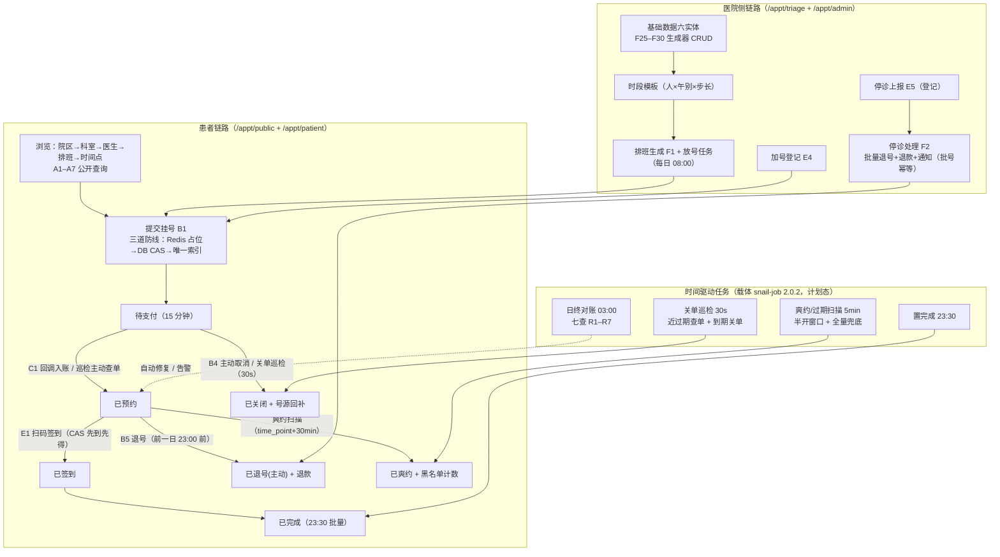

# 00 · 项目地图（一页概览）

> **号源 QueueDepth** · 医院门诊预约挂号系统（求职演示项目，代码缩写 `appt`）
>
> **合规声明**：全部数据虚构，不使用真实医院 / 科室 / 医务人员名称；不问诊、不诊断、不开放；支付仅 Mock 渠道。本系统不提供医疗服务（技术方案 §5）。
>
> 本目录是**技术理解图谱**（derived docs），不替代权威文档：业务规则以 `PRD.md` 为准、接口形态以 `api-contract.md` 为准、字段以 `database-design.md` 为准、排期以 `ROADMAP.md` 为准、红线以 `redlines.md` 为准。本文与权威文档冲突时，以权威文档为准并先报告。

## 标注约定（全套 7 份通用）

| 标记 | 含义 |
|---|---|
| **已核实 DDL** | 事实经 `appt_schema.sql` 与库 `appt` 的 `information_schema` 逐项比对确认（本轮比对零差异） |
| **已核实代码** | 事实经当前仓库源码 / 配置 / 冒烟实测确认 |
| **设计态** | 契约 / 技术方案已规定，但 `appt` 模块代码尚未生成（当前仅 `.gitkeep` 骨架），**不是已实现行为** |
| **待确认** | 文档未定义或未拍板，列于本文 §6 待决策清单，**不替业务规则作决定** |

## 1. 这是什么

单医院 + 多院区的门诊预约挂号系统：患者在 7 天滚动窗口内预约「院区 → 科室 → 医生 → 时间点」，在线支付后到院扫码核销；医院侧维护排班放号、停诊处理、限购与黑名单治理、日终对账。核心业务不变量是「一个号源同一时间点只成交一笔」。

- 技术栈：Spring Boot 4.1 / JDK 21 / MyBatis-Plus / MySQL 8 / Redis + Redisson，框架基底 RuoYi-Vue-Plus 6.0.0（backend/AGENTS.md §1）
- 架构：**模块化单体**，不上微服务、不用 MQ、不用 ES、显式关闭多租户、不建物理外键（PRD §12、技术方案 §1.1、database-design §1 公约 12）
- 20 张业务表（`appt_*`）已在库建成且 **0 行数据**；业务代码（S1–S7）尚未生成

## 2. 角色与端

| 角色 | 端 | 能力 | 数据范围 |
|---|---|---|---|
| 患者 | uni-app（C 端模式，**仓待建**） | 浏览 / 挂号 / 支付 / 我的预约 / 退号 / 就诊人 / 就诊码 / 收藏 / 消息 | 仅本人及名下就诊人 |
| 分诊 / 医护 | uni-app（分诊台模式，同一套代码按角色切换，PRD D3） | 扫码签到 / 手动补签 / 加号登记 / 停诊上报 | 本人在岗院区（本期简化，**待确认 Q1**） |
| 排班管理员 | plus-ui 后台（已建上游基线） | 基础数据 / 排班生成 / 停诊处理 / 挂号单与支付单管理 | 限定院区（框架数据权限） |
| 超级管理员 | plus-ui 后台 | 全部 + 黑名单 + 对账 + 看板 | 全部 |

来源：PRD §3、§10.1；四层 API 边界（public / patient / triage / admin）见 api-contract.md §1.1。

## 3. 仓库与业务包

| 本地目录 | 远端 | 角色 | 状态（已核实代码：README 仓库地图） |
|---|---|---|---|
| `backend` | qd-appt-backend | RuoYi-Vue-Plus + 业务模块 `appt`（包 `org.dromara.appt`，表前缀 `appt_`，API `/appt/**`，Redis `appt:*`） | 框架基线 + 20 表空结构；业务代码未生成 |
| `admin` | qd-appt-admin | plus-ui 管理后台 | 上游基线 + dev 代理 8082；dev 端口 8083 |
| `app` | qd-appt-app | uni-app 患者 + 分诊台双角色 | **待建仓** |
| `docs` | qd-appt-docs | 项目文档（本目录所在仓） | 已建 |

九大业务包（技术方案 §1.2，本轮已落定 `appt_suspend_record` 归 `triage`）：`common`（枚举/异常/Redis Key/Lua）· `schedule`（基础数据 + 排班号源 + 生成器 + 放号）· `registration`（挂号/限购/黑名单）· `payment`（支付/退款/渠道/回调/巡检）· `triage`（签到/加号/停诊上报与处理）· `account`（就诊人/收藏）· `reconcile`（对账）· `notice`（站内信）· `job`（定时任务）。

## 4. 核心实体速览

完整领域模型见 `01-domain-model.md`，物理表结构见 `02-database-erd.md`。一句话版：

**号域**：科室（全局树）→ 医务人员（挂 campus+dept，一行 = 一个出诊身份）→ 时段模板（午别×起止×步长）→ 排班（人×日期×午别，稀疏）→ **号源（一个 Slot = 一个号，time_point 显式落库）**；
**交易域**：挂号单（金额快照 + active_flag 唯一性技巧）→ 支付单（15 分钟时限）→ 退款单；
**治理域**：黑名单（账号口径）、停诊登记（批号幂等）、对账结果、任务日志、回调记录（append-only）。

## 5. 业务闭环

**图说明**：一张图回答「一笔号从生成到消亡经过哪些环节、谁触发」。患者链路是主线，医院侧链路供给号源，时间驱动任务是无人值守的兜底（关单、爽约、过期、置完成、对账）。
**涉及的业务规则**：预约窗口 `[今日+1, 今日+7]` 每日 08:00 放号（PRD §6.1、D1）；支付时限 15 分钟（§6.6、§14.2-3）；退号时限就诊前一日 23:00（§6.7）；爽约判定 `time_point + 30min`（§6.8）；停诊被动退号不计爽约（§6.10、红线 8）；对账七查（§9.6）。
**实现状态**：端点与规则 = 设计态（契约 v0.1 已定稿，代码未生成）；放号 / 巡检 / 扫描 / 对账任务 = 设计态（snail-job 落地步骤未执行，**待确认 Q12**）。

## 6. 文档索引与待决策清单

### 6.1 本目录索引

| 文档 | 内容 | 图 |
|---|---|---|
| 00-project-map.md（本文） | 一页概览 + 业务闭环 + 待决策清单 | 1 flowchart |
| 01-domain-model.md | 业务领域模型：实体、业务含义、基数、快照冗余 | 1 erDiagram |
| 02-database-erd.md | 物理 ERD 按五域拆分；PK/UNIQUE/CHECK；「无物理外键」声明 | 5 erDiagram |
| 03-appointment-state-machine.md | 挂号单八态状态机 + 边明细（触发/角色/副作用）+ Slot/Payment/Refund 附图 | 4 stateDiagram |
| 04-critical-flows.md | 创建预约 / 退号退款 / 扫码核销时序图（三道防线、事务、CAS 竞争、异常分支） | 3 sequenceDiagram |
| 05-business-rule-matrix.md | 预约/取消/超时/爽约/黑名单/限购/退款/停诊/收费规则矩阵（条件→动作→例外→来源） | 表格 |
| 06-system-architecture.md | 组件架构、四层边界与状态单柱、已实现 vs 计划中对照、明确不用的技术 | 1 flowchart + 1 分层图 |

### 6.2 待决策清单（资料不足处，未替业务规则作决定）

| # | 事项 | 现状与来源 | 阻塞 |
|---|---|---|---|
| Q1 | 分诊角色数据范围（在岗院区）的存储方式：`sys_user` 扩展字段 or 数据权限 | 本期简化「本人在岗院区」，未定实现（PRD §14.3；契约 §11 待确认 #7） | S6 E3 当日签到列表 |
| Q2 | F16 渠道配置落业务表还是 `sys_config` | 契约 §11 待确认 #8。**若落业务表，20 张表将扩为 21 张** | S4 / S7 |
| Q3 | `notice.type` 站内信类型线值未定义 | 契约 §6 注：S6 补条目时定义（七种通知场景已列，PRD §6.12） | S6 联调 |
| Q4 | 初始数据（seed）未生成 | 用户已定「先不生成」（ROADMAP §6 #4/#7）；规模 PRD §11（~9,000 号源 / ~2,000 挂号单覆盖 8 态）；seed 硬约束已补入 PRD §11 | S5 性能对比、集成测试②③演示数据、S7 对账演示 |
| Q5 | 停诊时**已签到**挂号单的处理 | 不参与批量退号、现场人工协调（PRD §6.10/§14.3）——**状态机中无对应边**，见 03 号文档 | 无（本期简化边界） |
| Q6 | 医务人员跨院区出诊 | 本期一行 = 一个出诊身份（campus_id 单值），后续拆 `staff_campus` 链接表（技术方案 M7 / PRD §14.3） | 无（已知边界） |
| Q7 | 就诊人证件被其他账号绑定的解绑流程 | 本期不做（PRD §14.3） | 无（已知边界） |
| Q8 | `medical_staff.clinic_type` 与 `slot_template.clinic_type` 冗余一致性 | 约定同 staff 所有模板 clinic_type 必须等于 staff.clinic_type，**由 Service 层校验，跨表无法用 CHECK**（database-design §6） | 无（Service 校验即设计） |
| Q9 | `reconcile_result.target_id` 混装三类 id 无 `target_type` 列 | 目标类型由 `check_type` 唯一决定（R1→slot、R4/R6→registration、R5→refund、R7→无）（database-design §6） | 无（读结果按 check_type 分派） |
| Q10 | 渠道密钥管理（mock 演示环境配置写法 / 真实渠道注入） | 契约 §11 待确认 #6 | S4 |
| Q11 | `architecture.md` 未建 | README 文档地图标注「待建」；06 号文档为事实快照，非其替代 | 无（后续补正式架构文档） |
| Q12 | snail-job 落地步骤未执行 | 载体已定 snail-job 2.0.2，但 `ry_job.sql`（sj_* 库）未导入、server 未启动（ROADMAP §6 #1 落地步骤） | S2 放号任务、S4 巡检、S6 扫描、S7 对账 |
| Q13 | `qd-appt-app` 仓未建 | README 仓库地图标注待建 | S3 患者端页面、S6 分诊台页面 |
| Q14 | Mock 渠道回调去重缺口 | `payment_callback.trade_no/notify_id` 可空，NULL 互不冲突；实际去重落在 `(payment_no, trade_no)`，对账 R3 兜底（database-design §3.5） | 无（已登记边界） |
| Q15 | B8–B10 就诊人改/删/设默认、E3 当日签到列表等 P1 端点条目 | 契约 §10 已列占位，字段条目待对应切片联调前补 | B8–B10 阻塞 S3 联调；E3 阻塞 S6 |

> 阅读顺序建议：本文 → `01` → `02` → `05`（规则）→ `03` → `04` → `06`。
