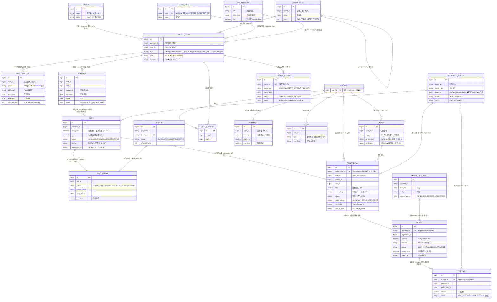

# 01 · 业务领域模型

> 上游依据：PRD §4.1 概念层级 / §4.2 表清单 · database-design.md §1–§3 · 技术方案 §1.2 · api-contract.md §2.7
> 本文描述**业务实体之间的关系**（领域层）；物理表、索引与约束见 `02-database-erd.md`。

## 1. 领域模型图

**图说明**：这张图回答「业务世界有哪些概念、彼此什么关系」。要点：① 号源供给链是 `医务人员 → 时段模板 → 排班 → 号源`；② 交易链是 `挂号单 → 支付单 → 退款单`；③ 治理对象（黑名单 / 停诊 / 对账 / 任务日志 / 回调）都以账号或号源为锚点。
**涉及的业务规则**：一行医务人员 = 一个出诊身份（PRD §14.3、技术方案 M7）；「一个 Slot = 一个号」无容量计数器（PRD §4.2-2、红线 2）；限购与黑名单按账号 `user_id` 口径（PRD §6.5/§6.9、红线 14）；证件唯一性走 `(id_type, id_no_hash)`（PRD §4.2-7、D-S1-3）。
**实现状态**：领域划分 = 设计态（技术方案 §1.2，`appt` 模块为空骨架）；`ACCOUNT` 即 `sys_user` 为**已核实代码**（RuoYi 框架表，患者复用，PRD §12）；所有关系均为业务逻辑关联，**库中无物理外键**（database-design §1 公约 12）——物理层面见 `02-database-erd.md`。

## 2. 实体业务含义速查

| 实体 | 业务含义 | 关键设计 | 来源 |
|---|---|---|---|
| Campus 院区 | 3 个院区，医务人员的属性与筛选维度 | 科室树**全局统一**，不按院区建树（切换院区按出诊人员过滤科室） | PRD §2、D5 |
| ClinicType 门诊类型 | 普通 / 夜间延时 / 知名专家，独立维度 | `code` 唯一 | PRD §2 |
| Department 科室 | 三级树（~40：8 一级/15 二级/20 叶子） | `parent_id` 根为 0；不挂院区 | PRD §4.1/§11 |
| MedicalStaff 医务人员 | ~60 人，关联 (campus_id, dept_id) | **一行 = 一个出诊身份**；`clinic_type` 为staff 自身属性（D-S1-7）；跨院区出诊为已知边界（M7） | PRD §4.1/§14.3 |
| SlotTemplate 时段模板 | 人 × 午别 × 起止 × 步长，~180 条 | 无容量字段，生成量 = 时长/步长；步长差异化（4/5~6/6~7/10 分钟） | PRD §4.2-4、§11 |
| FeeStandard 收费标准 | 职称 × 门诊类型 → 挂号费 | 快照不追溯（I2）；停用行仍占唯一键 → 重新启用而非 insert | PRD §6.4、database-design §6 |
| Schedule 排班 | 人 × 日期 × 午别，~500 条稀疏 | 无排班的日子不建记录；`UNIQUE(staff_id, visit_date, period)` 保幂等 | PRD §6.2/§11 |
| Slot 号源 | **一个 Slot = 一个号**，~9,000 条 | `time_point` 显式落库（红线 1）；5 列冗余免 join（D-S1-2）；`fee` 快照 | PRD §4.2、红线 1/2 |
| SlotLedger 号源台账 | 号源每次状态变更一条 | append-only；对账倒查依据 | 技术方案 §3.6 |
| Account 账号 | 复用 `sys_user`（专属角色，实名） | 患者不新建账号体系 | PRD §12 |
| Patient 就诊人 | 每账号 ≤10；卡号院内唯一 / 身份证全局唯一 | `id_no_hash` 让「证件唯一」与「加密存储」共存；`is_default` NULL 语义保一账号一默认 | PRD §4.2-6/7、D-S1-3/8 |
| Registration 挂号单 | 核心交易实体，八态 | `fee` 金额快照；`active_flag` 1/NULL + `chk_reg_active`；6 列冗余快照 | PRD §4.2/§7.2、M1 |
| Payment 支付单 | 15 分钟时限，本期仅 mock 渠道 | `expire_time` 派生自同一配置项；回调幂等 CAS | PRD §6.6 |
| Refund 退款单 | 挂号场景一律全额退 | `FAILED` 终态；再退须人工另建单 | PRD §6.6、契约 §5.5 |
| Blacklist 黑名单 | 半年内退号+爽约合计 6 次 → 限制半年 | **账号级**（M13）；到期自动解除 | PRD §6.9 |
| Notice 站内信 | 七种通知场景 | 无写端点，系统事件触发；`type` 线值待确认（Q3） | PRD §6.12、database-design §6 |
| SuspendRecord 停诊登记 | 停诊范围 + 批号幂等锚点 | E5 登记、F2 处理两段式；区间停诊拆 N 条共用批号（D-S1-5） | 契约 §7.5/§8.3 |
| ReconcileResult 对账结果 | 七查 R1–R7 落库 | `target_id` 无类型列，按 `check_type` 分派（Q9） | 技术方案 §3.6 |
| JobLog 任务日志 | 定时任务批号/起止/影响行数 | `SKIPPED` 承载红线 13；启动补偿检查 | 红线 13、技术方案 §3.3 |
| PaymentCallback 回调记录 | 渠道回调原始报文 | append-only；`(payment_no, trade_no, notify_id)` 去重（NULL 缺口见 Q14） | 技术方案 §3.5 |

## 3. 三个必须理解的领域设计

1. **快照冗余**：`registration` 冗余 staff/dept/campus/visit_date/period/time_point 六列 + `fee` 金额快照；`slot` 冗余五列。排班生成后不再变更（唯一变更源是停诊走 `status`）；后台改医生科室/院区**不追溯**已生成号源——「该医生已调至 B 院区但历史号源仍挂 A」属预期不是 bug（database-design §6、D-S1-2）。
2. **`active_flag` 的 NULL 技巧**：`UNIQUE(slot_id, active_flag)` 中 active_flag=1 有效、终态置 NULL，MySQL 唯一索引 NULL 互不冲突 → 号源回池复用不撞键（M1，红线 4）；`chk_reg_active` CHECK 约束把「状态 ↔ active_flag」绑定成 DB 事实（database-design §3.3）。
3. **账号口径**：限购「同时持有 ≤3」与黑名单统计均按 `user_id`（防多就诊人绕过，M13/红线 14）；同科室同日、同时间点两条限购按 `patient_id` + 联合唯一索引兜底（PRD §6.5）。
