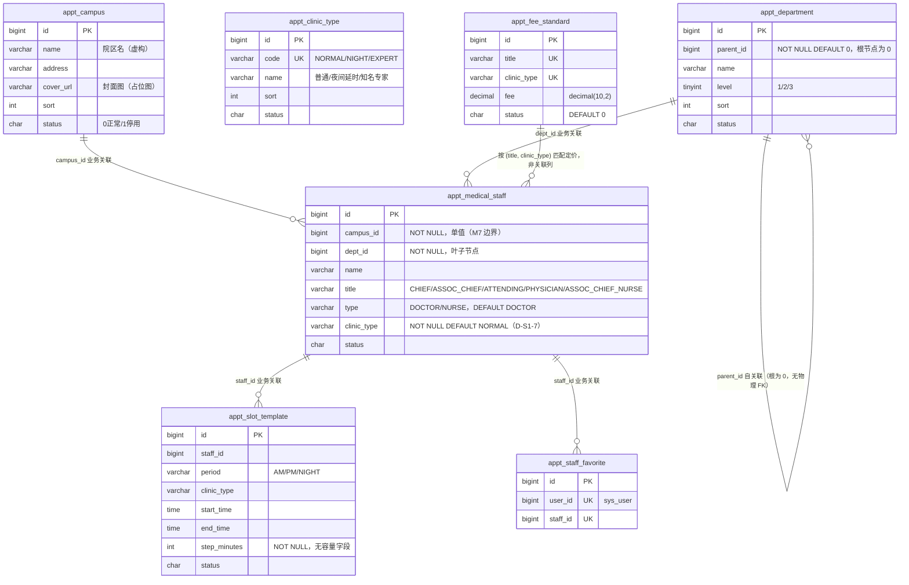
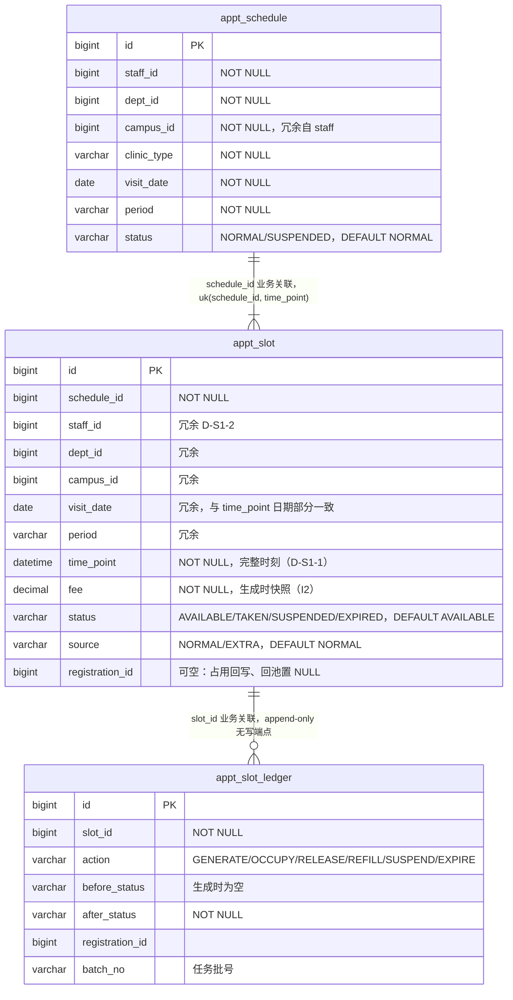
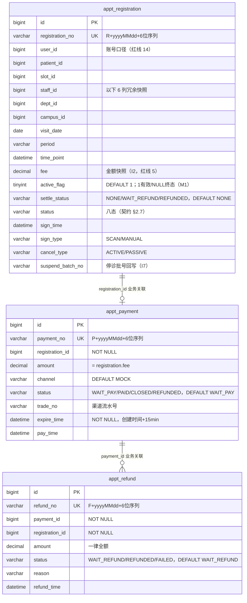
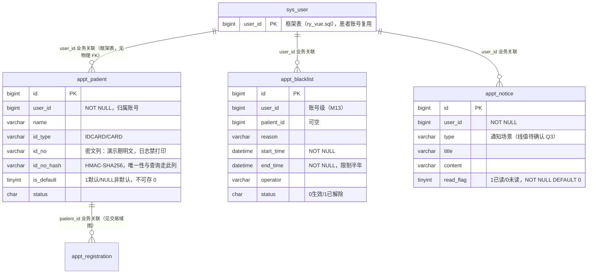
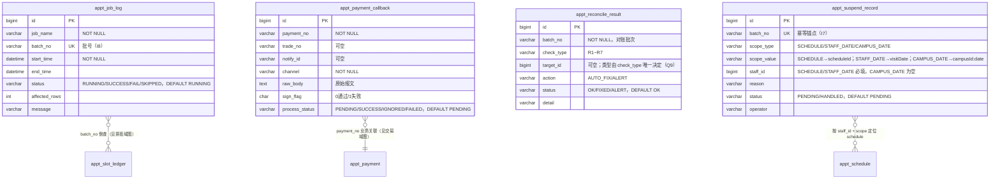

# 02 · 数据库 ERD（按业务域拆分）

> 依据：`database-design.md` §3（字段级唯一权威）+ `backend/script/sql/appt_schema.sql` + 库 `appt` 实测。
> **全部表结构已经 DDL ↔ `information_schema` 逐项比对零差异**（列/可空/默认值/注释/索引/CHECK/字符集），20 张业务表当前 **0 行**。
>
> ## 读前必知：本库**没有任何物理外键**
>
> - 依据：database-design §1 公约 12「不建外键」——RuoYi 惯例；外键会牵制 append-only 表与批量任务，且妨碍演示数据清理。
> - 下文所有表间连线均为**业务逻辑关联**（靠应用层保证一致性 + 删除前引用校验），不是 DB 级 FK。
> - 所有 20 张表共享五件套审计列（`create_dept` / `create_by` / `create_time` / `update_by` / `update_time`，`create_time` 默认 `CURRENT_TIMESTAMP`，`update_time` 默认 `ON UPDATE CURRENT_TIMESTAMP`），图中不重复画出。主键一律 `bigint` 雪花（`ASSIGN_ID`），无 `AUTO_INCREMENT`、无 `del_flag`、无 `@Version`。
> - 字段只画 ERD 关键列；**全量字段表以 database-design.md §3 为准**。

## 1. 基础数据域（database-design §3.1）

**图说明**：后台「基础数据」菜单维护的六个实体（PRD §10.2）+ 收藏表。回答「号源上游的主数据长什么样」。
**涉及的业务规则**：科室树全局统一、不按院区建树，切院区按 `(campus_id, dept_id)` 有出诊人员过滤（PRD §2/D5）；模板不设容量字段（PRD §4.2-4）；收费标准 `(title, clinic_type)` 唯一、停用行仍占键 → 重新启用而非 insert（database-design §6）。
**实现状态**：**已核实 DDL**（表 / 列 / 唯一键与库一致）；行数量级 3 / 3 / ~40 / ~60 / ~180 / — / —（database-design §3，PRD §11）。

## 2. 排班与号源域（database-design §3.2）——系统核心

**图说明**：系统的资源核心。回答「一个号从模板到可约、被占、回池、过期，数据库里留下什么」。
**涉及的业务规则**：`time_point` 必须显式落库、禁止「起始时间 + 固定步长」现算（红线 1；实测间隔 4/5~6/6~7/10 分钟且被占用点直接从列表消失）；一个 Slot = 一个号、无容量计数器（红线 2）；排班幂等靠 `UNIQUE(staff_id, visit_date, period)`（PRD §6.2）；加号 Slot `time_point = 该午别 MAX + 模板步长`，撞 `uk(schedule_id, time_point)` 重算重试（PRD §6.11、契约 §7.4）。
**实现状态**：**已核实 DDL**；slot 行数量级 ~9,000（PRD §11）；`slot_ledger` 为 append-only，**无任何写/读端点**（database-design §6，S7 决定是否补查询页）。

## 3. 交易域（database-design §3.3）—— correctness 集中区

**图说明**：钱与号的绑定关系。回答「一笔挂卡的支付 / 退款在数据库里如何保证不多扣、不少退、不重复退」。
**涉及的业务规则**：三道防线之三——`UNIQUE(slot_id, active_flag)` 兜底（红线 3/4、M1）；`CHECK chk_reg_active`：`{WAIT_PAY,BOOKED,SIGNED} ⇔ active_flag=1`、`{COMPLETED,CLOSED,CANCELED_ACTIVE,CANCELED_PASSIVE,NOSHOW} ⇔ active_flag IS NULL`（database-design §3.3，绕过状态单柱的 UPDATE 会报 3819）；限购两联合唯一键 `(patient_id, dept_id, visit_date, active_flag)`、`(patient_id, time_point, active_flag)`（PRD §6.5）；`(user_id, status)` 支撑「同时持有 ≤3」计数与黑名单统计（M3/M13）；`(status, time_point)` 支撑爽约扫描。
**实现状态**：**已核实 DDL**（含 `chk_reg_active` CHECK 在库中存在）；行数量级 registration ~2,000 / payment ~2,000 / refund ~300（PRD §11）；状态机详见 `03-appointment-state-machine.md`。

## 4. 账号与运营域（database-design §3.4）

**图说明**：账号侧实体 + 两张治理表。回答「患者身份、收藏之外的账号相关数据落在哪」。
**涉及的业务规则**：`UNIQUE(id_type, id_no_hash)` 让「证件号唯一」与「加密存储」共存（D-S1-3、PRD §4.2-7）；`UNIQUE(user_id, is_default)` 保一账号至多一个默认就诊人（D-S1-8，非默认必须存 NULL）；黑名单按账号口径，半年内退号+爽约合计 6 次 → 限制半年（PRD §6.9、红线 14）；`notice` 无写端点，由七种系统事件触发（PRD §6.12）。
**实现状态**：**已核实 DDL**；patient 行数量级 35（20 账号 / 35 就诊人，PRD §11）；`sys_user` 为**已核实代码**（框架表存在于 appt 库）。

## 5. 支撑域（database-design §3.5，M10 新增四表）

**图说明**：可观测与幂等的四张表。回答「任务跑了什么、回调收过什么、对账修了什么、停诊批到哪一步」。
**涉及的业务规则**：回调去重 `UNIQUE(payment_no, trade_no, notify_id)`，但 trade_no/notify_id 可空 → Mock 渠道实际去重落在 `(payment_no, trade_no)`、对账 R3 兜底（database-design §3.5，Q14）；停诊两段式：E5 登记（PENDING）→ F2 处理（HANDLED），批号即幂等锚点（契约 §7.5/§8.3）；`SKIPPED` 状态承载红线 13「拿不到锁跳过本轮并记日志」。
**实现状态**：**已核实 DDL**；`payment_callback` 为 append-only、**无任何端点**（database-design §6）；`suspend_record` 归 `triage` 包（2026-10-18 落定，技术方案 §1.2）；四表均无行数量级估计（演示量级，事件/任务驱动，database-design §3 说明）。

## 6. 与框架表的边界

`appt` 库内另有框架表（`sys_user` / `sys_menu` / `sys_role` / `gen_table` 等，来自 `ry_vue.sql`）+ `appt_s0_cleanup.sql` 清理掉的演示菜单。业务代码只读 `sys_user`（账号复用，PRD §12）；菜单与权限由 RuoYi 管理端维护，**不在 20 张业务表内**，本文不展开。
