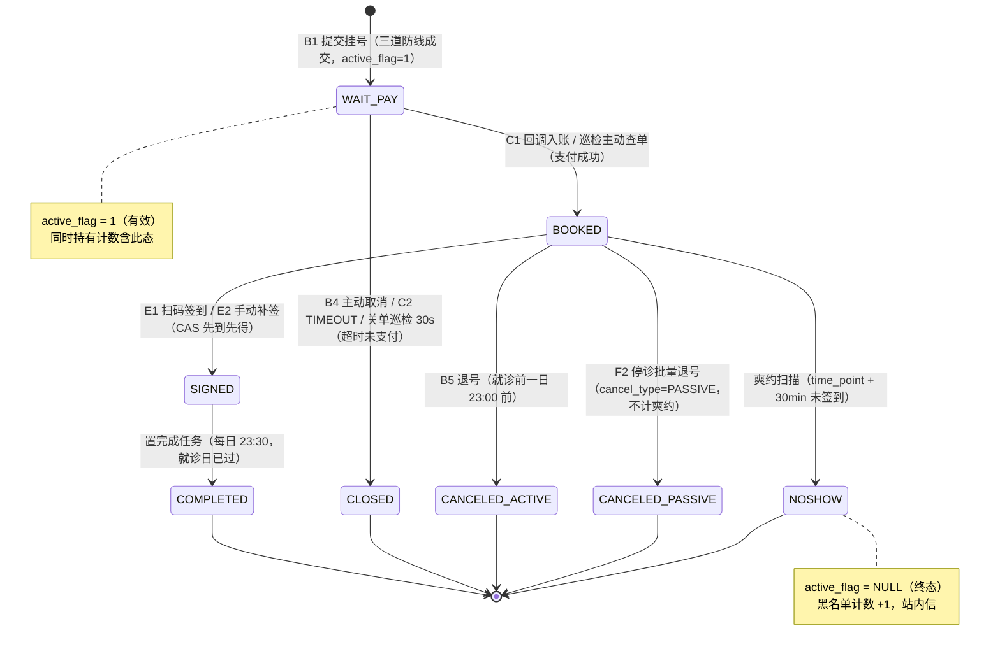
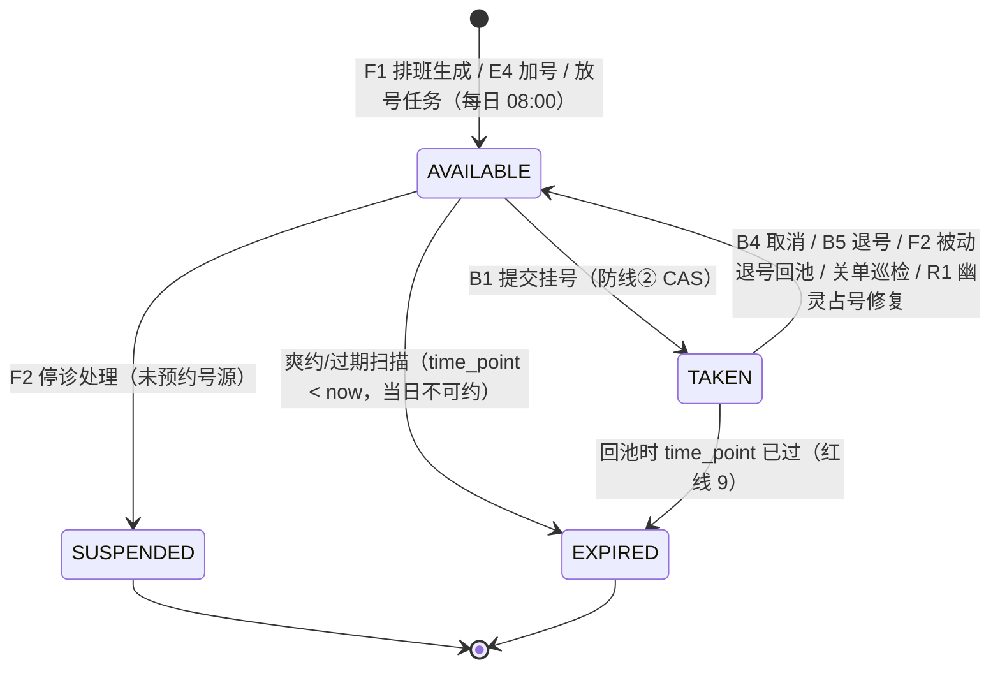
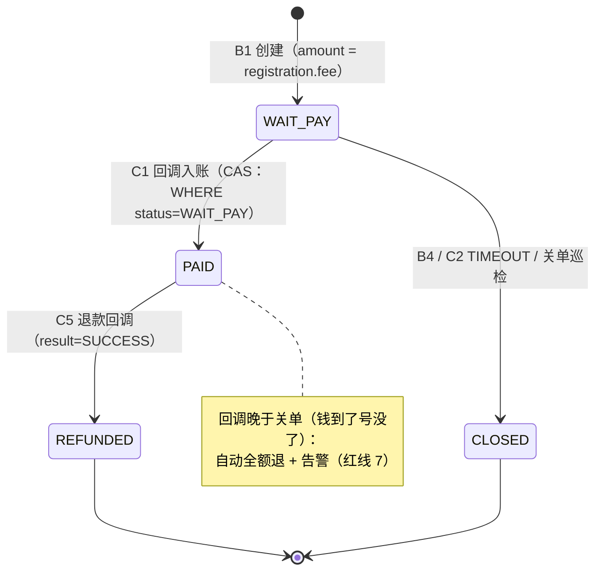
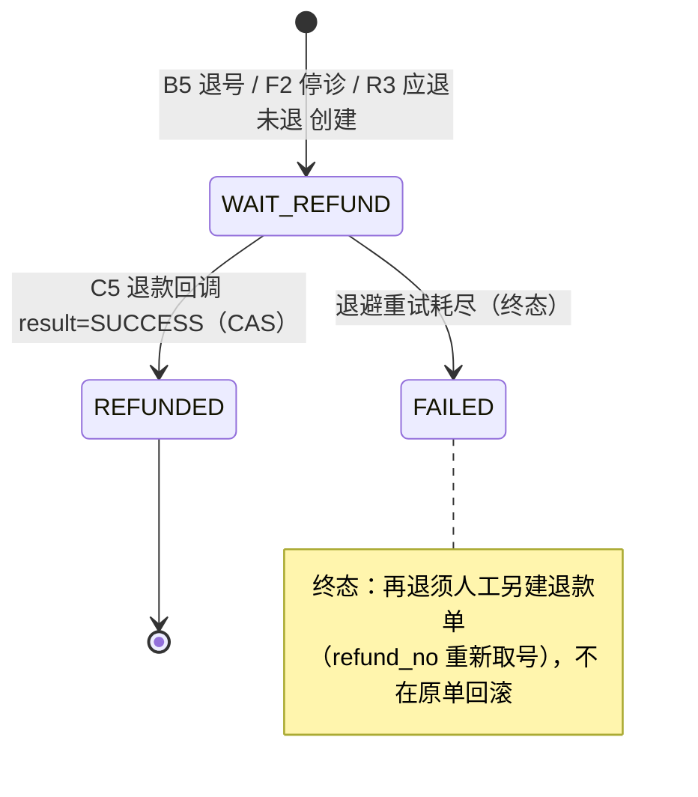

# 03 · 预约订单状态机

> 依据：PRD §7（状态机权威）· api-contract.md §2.7（线值）/ §9.1（触发源矩阵）· 技术方案 §3.3 / §3.4（扫描与关单）· database-design.md §3.3（`chk_reg_active`）。
> **所有状态流转必须经 `*StateService` 单柱**（合法性校验 + 条件 CAS + 台账），禁止任何路径绕过（红线 11）——这是缓存一致性与对账可审计的根基。

## 1. Registration 挂号单（主状态机，八态）

**图说明**：一笔挂号单从创建到消亡的全部合法路径。回答「什么事件让订单改变状态、改变后牵连什么」。
**涉及的业务规则**：待支付期间 Slot 即「已占」，他人不可挂（PRD §7.1 注）；超时未支付关单**不计**黑名单（PRD §7.2 注、红线 8）；主动退号计入黑名单统计口径、停诊被动退号不计（契约 §4.5、PRD §6.9）；爽约由扫描判定不经端点（PRD §6.8）。
**实现状态**：设计态（`appt` 模块为空骨架）；线值与触发源矩阵**已核实文档**（契约 §9.1 本轮已补 F2 触发源）；`chk_reg_active` CHECK **已核实 DDL**。

## 2. 挂号单状态边明细（触发 → 角色 → 副作用）

| 状态边 | 触发条件 | 执行角色 | 副作用（ Slot / 资金 / 缓存 / 台账 / 通知 ） | 来源 |
|---|---|---|---|---|
| — → WAIT_PAY | `slotId` 可约 + 排班未停诊 + 日期在窗口 + 账号未黑名单 + 持有 <3；`Idempotency-Key` 防双击 | B1 提交挂号（患者） | Slot `AVAILABLE→TAKEN`；INSERT payment（WAIT_PAY，expire=+15min）；Redis 占位 key；余量缓存 DECR（afterCommit，Lua 守卫）；站内信「挂号成功待支付」 | 契约 §4.1、技术方案 §3.1 |
| WAIT_PAY → BOOKED | 渠道回调 / 巡检主动查单确认已支付（金额与 `registration.fee` 快照核对一致） | C1 回调（公开，验签即身份）/ 巡检任务 | Payment `WAIT_PAY→PAID`（CAS 唯一入账点）；落 `payment_callback`；站内信「支付成功」 | 契约 §5.1、技术方案 §3.5 |
| WAIT_PAY → CLOSED | `expire_time <= now` 且渠道确认未支付；或患者主动取消；或 C2 TIMEOUT 演示按钮 | B4（患者）/ 关单巡检 30s / C2 | Slot 回补 `TAKEN→AVAILABLE`（`time_point` 已过则 `EXPIRED`，红线 9）；Payment→CLOSED；余量缓存 +1；台账；站内信「超时关单」；**不涉及退款、不计黑名单** | 契约 §4.4、技术方案 §3.4、红线 8 |
| BOOKED → SIGNED | `now ≥ 就诊日 00:00` 且 `now < time_point + 30min` 且 `status=BOOKED` | E1 扫码 / E2 补签（分诊） | `sign_time` / `sign_type=SCAN\|MANUAL`；与爽约扫描竞争同一 CAS，**先到先得** | 契约 §7.1/§7.2、技术方案 §3.3 |
| BOOKED → CANCELED_ACTIVE | `now < 就诊前一日 23:00`（否则 `REFUND_DEADLINE_PASSED`） | B5 退号（患者） | Slot 回池（已过 time_point → `EXPIRED`）；已支付则 INSERT refund（WAIT_REFUND）+ `settle_status=WAIT_REFUND`；余量缓存 +1；**计入黑名单统计口径** | 契约 §4.5、PRD §6.7/§6.9 |
| BOOKED → CANCELED_PASSIVE | 停诊处理（F2）范围内；**已签到的单不参与**（见 §5） | F2 停诊处理（管理员） | Slot 回池；`cancel_type=PASSIVE`、`suspend_batch_no` 回写；已支付则批量退款；站内信；**不计爽约** | 契约 §8.3、PRD §6.10、红线 8 |
| BOOKED → NOSHOW | `time_point + 30min` 仍未签到（半开窗口主批 + `time_point <= now-35min` 全量兜底，M2） | 爽约扫描任务（5min） | `active_flag=NULL`；黑名单计数 +1；站内信「爽约记录」；Slot 最终由过期扫描置 `EXPIRED` | 契约 §9.1、技术方案 §3.3、红线 13 |
| SIGNED → COMPLETED | 已签到且就诊日已过（每日 23:30 批量） | 置完成任务 | `active_flag=NULL`；无资金动作 | 契约 §9.1、技术方案 §3.3 |

## 3. Slot 号源（四态）

**图说明**：号源这一行记录的生命周期。回答「一个时间点什么时候可约、被谁占、怎么回到池子」。
**涉及的业务规则**：退号回池时若 `time_point` 已过 → 置「已过期」而非「可约」（红线 9）；列表只返回 `status=可约` 的时间点，被占用的不出现（PRD §6.2）；「已停诊 / 已过期」为终态（PRD §7.1）。
**实现状态**：设计态；`TAKEN→AVAILABLE` 行的 F2 触发源为**本轮文档核实补齐**（契约 §9.1，此前矩阵漏列）；DDL 中 `status` 为 `varchar(16)` 存线值（**已核实 DDL**）。

## 4. Payment 支付单（四态）与 Refund 退款单（三态）

**图说明**：资金两侧的状态机。回答「钱在哪一步、什么条件下退、重复回调为什么不重复退」。
**涉及的业务规则**：回调幂等以 `payment_no` + 状态 CAS 为唯一入账点，重复回调第二次影响 0 行（PRD §6.6、技术方案 §3.5）；「钱到了号没了」必须自动全额退 + 告警，不是返回成功就算了（红线 7）；退款一律全额、不做部分退款（PRD §6.6）；退款失败重试耗尽置 `FAILED` 进人工队列（契约 §5.5）。
**实现状态**：设计态；`FAILED` 线值为**已核实 DDL/文档**（2026-10-18 同步三处）。

## 5. 文档未定义 / 简化的状态与规则（不替业务作决定）

| # | 事项 | 文档现状 | 性质 |
|---|---|---|---|
| U1 | **停诊时已签到（SIGNED）的挂号单** | PRD §6.10 / §14.3：不参与批量退号，现场人工协调；**状态机中不存在 `SIGNED → CANCELED_PASSIVE` 边**，后续可补 | 本期简化边界（待后续迭代定义） |
| U2 | **改约** | PRD D4 / §13.2：本期不做；实际路径 = B5 退号 + 重新 B1，**无专门状态边** | 明确不做 |
| U3 | 「已关闭」的两个来源 | PRD §7.2 将「超时未支付」与「主动取消」分别列出但**共用同一终态 `CLOSED`**，无法从单据区分关闭原因（无 cancel_reason 列） | 设计如此（如需区分须加列，**未决策**） |
| U4 | R4「给了号没收钱」（BOOKED 但 Payment 非 PAID） | 技术方案 §3.6：**只告警不自动修**（业务决策不是技术决策） | 已定义为例外 |
| U5 | 退款单 `FAILED` 后再退 | 契约 §5.5：人工另建退款单（`refund_no` 重新取号），不在原单回滚复用 | 已定义 |
| U6 | `active_flag` 与 `status` 的绑定 | `chk_reg_active` CHECK 保证 `{WAIT_PAY,BOOKED,SIGNED}⇔1`、终态五态⇔NULL；绕过状态单柱的 UPDATE 直接报 3819 | 已定义（**已核实 DDL**） |

## 6. 状态机守护的不变量（技术方案 §2）

| 不变量 | 保证机制 | 失效兜底 |
|---|---|---|
| I1 一个号源最多一笔有效挂号 | 事务内 slot 行级 CAS + `UNIQUE(slot_id, active_flag)` | 对账 R1/R2 |
| I3 三张状态机只走合法边 | `*StateService` 单柱 + 条件 CAS | 对账 R1/R2/R6 |
| I5 回调至少处理一次、状态只流转一次 | 回调记录表 + `payment_no` CAS 入账 + 巡检查单 | 对账 R3/R4 |
| I7 停诊 / 退款批量不重不放 | 批号 + CAS + 分批事务（≤100/批） | 对账 R6 |

> I2 / I4 / I6 / I8 见 `01-domain-model.md` §3 与 `05-business-rule-matrix.md`。
