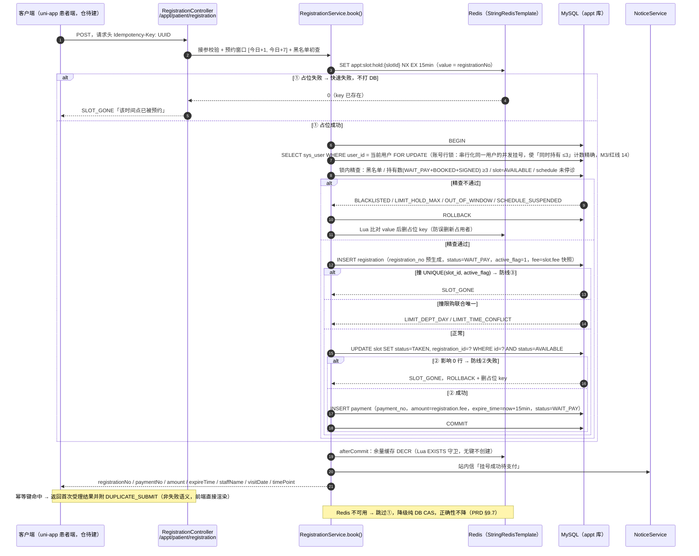
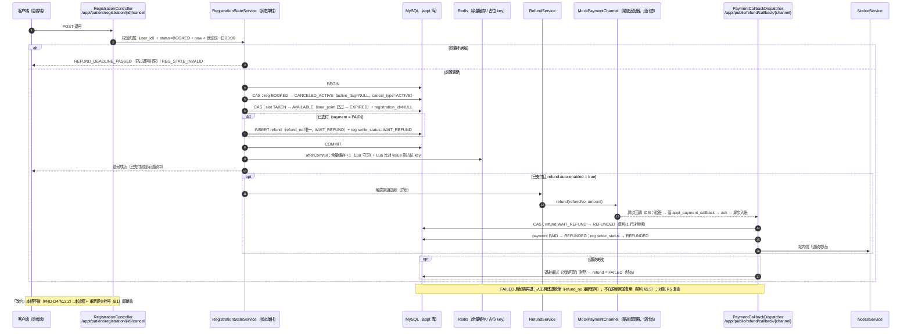
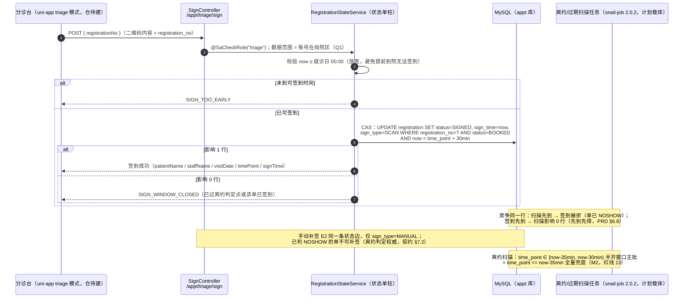

# 04 · 关键流程时序图

> 依据：api-contract.md §4–§5 / §7（端点契约）· 技术方案 §3.1 / §3.3 / §3.4 / §3.5（事务顺序、CAS、巡检）· PRD §6.5 / §6.6 / §6.7 / §6.8。
>
> **实现状态声明（重要）**：`ruoyi-modules/appt` 当前仅有 `.gitkeep` 骨架（**已核实代码**），以下三张图描述的是**契约 + 技术方案规定的设计态行为**，不是已运行代码的实测路径。图中组件只出现项目真实存在或明确选型的：MySQL / Redis（已存在）、Spring Boot 框架与 Sa-Token（已存在）、uni-app / plus-ui（uni-app 仓待建）、mock 渠道 / snail-job / `@Async` 线程池（设计态）。**不出现 MQ / ES**（红线 16）。

## 1. 创建预约（B1，并发重点）

**图说明**：系统并发正确性（G2：同一时间点只成交一人）的完整落地。回答「一笔挂号在哪些防线被拦、事务里做什么、失败怎么补偿」。
**涉及的业务规则**：三道防线顺序不可省——Redis 占位（优化层，可摘除）→ DB 行级 CAS（真相层）→ 唯一索引（兜底层）（红线 3）；限购三条 + 黑名单前置校验、服务端不信任前端（PRD §6.5、红线 10）；金额只认 `slot.fee` 快照，请求体携带金额一律忽略（契约 §4.1）；一个 Slot = 一个号（红线 2）。
**实现状态**：**设计态**（契约 §4.1 + 技术方案 §3.1 规定的事务顺序）；验收口径：50 并发争抢同一时间点恰好 1 笔成功（PRD §9.1，集成测试①绑 S3）。

## 2. 取消 / 退号（B5，含退款异步链路；「改约」= 本流程 + 重新挂号）

**图说明**：售后退款的完整链路（交易链最大亮点之一）。回答「退号先动什么、退款为什么必须异步、重复退款怎么防」。
**涉及的业务规则**：退号时限就诊前一日 23:00（PRD §6.7）；回池时 `time_point` 已过 → 置「已过期」而非「可约」（红线 9）；已支付则自动全额退（PRD §6.6 退款规则：主动退号 ✅）；主动退号**计入**黑名单统计口径（PRD §6.9）；退款回调必须真异步：验签 → 落库 → ack → 异步入账（红线 7）；`refund_no` 唯一 + 状态 CAS 防重退（PRD §6.6）。
**实现状态**：**设计态**（契约 §4.5 / §5.5 + 技术方案 §3.5）；待支付状态的取消（B4）与本流程同事务形状（三步 CAS 以待支付为条件，不涉及退款，契约 §4.4）。

## 3. 扫码核销（E1，与爽约扫描的竞争）

**图说明**：履约侧的正确性竞争。回答「签到和系统判爽约谁说了算、为什么必须 CAS 而不是先查后改」。
**涉及的业务规则**：可签到时间就诊日当天 00:00 起（PRD §6.8）；超时判定点 `time_point + 30min`（PRD §6.8、§14.2-5）；签到与扫描竞争同一 CAS，先到先得（PRD §6.8、技术方案 §3.3）；补签只覆盖「患者已到院但扫码失败」。
**实现状态**：**设计态**（契约 §7.1 / §7.2 + 技术方案 §3.3）；E3 当日签到列表端点为 P1 占位（契约 §7.3，Q1/Q15）。

## 4. 其他流程的图在哪

| 流程 | 说明位置 |
|---|---|
| 超时关单与号源回补（30s 巡检两段式） | `03-appointment-state-machine.md` §2（`WAIT_PAY→CLOSED`、`TAKEN→AVAILABLE` 边）+ `05-business-rule-matrix.md` §3 |
| 支付回调幂等（C1，含「钱到了号没了」分支） | `03-appointment-state-machine.md` §4（Payment 状态机注记） |
| 停诊批量处理（F2：退号 + 退款 + 通知，批号幂等） | `03-appointment-state-machine.md` §2（`BOOKED→CANCELED_PASSIVE` 边）+ `05-business-rule-matrix.md` §7 |
| 日终对账七查（R1–R7） | `05-business-rule-matrix.md` §8 + `00-project-map.md` 业务闭环图 |
