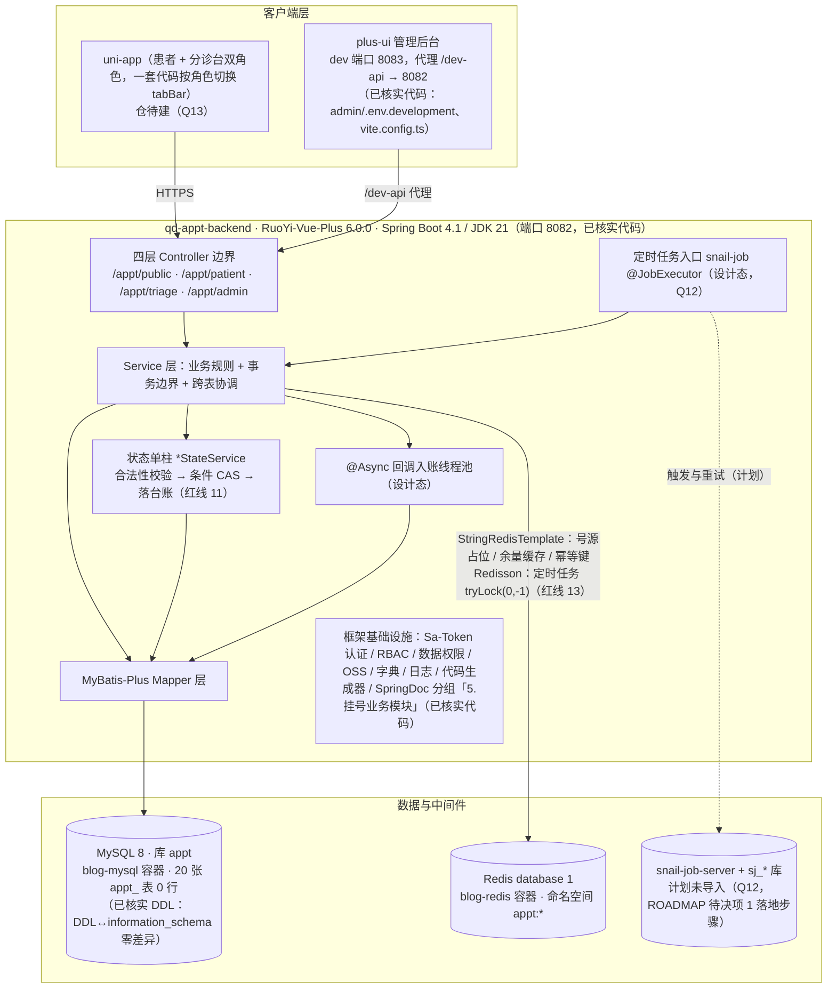
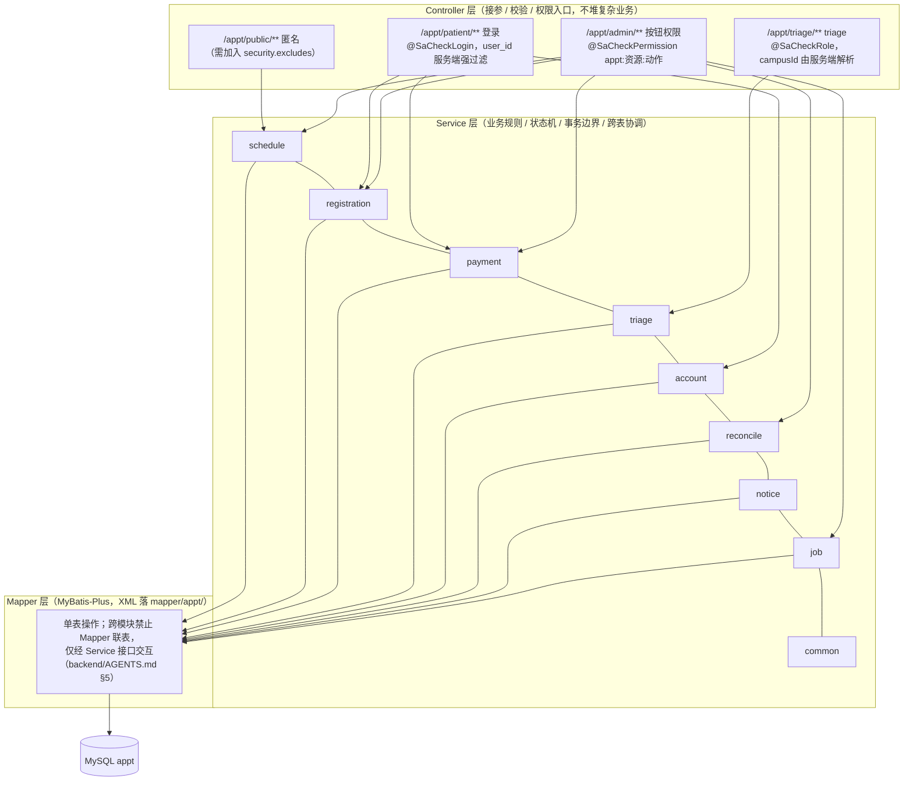

# 06 · 系统架构

> 依据：技术方案 §1（架构权威）· backend/AGENTS.md §1/§2/§5/§7/§8（已核实代码事实）· ROADMAP §2（切片）· README 仓库地图。
> 本文是**当前状态的事实快照**；正式架构文档 `architecture.md` 尚待建（README 文档地图，**Q11**），建成后本文应被其取代或合并。

## 1. 组件与部署

**图说明**：真实组件、职责与调用方向。回答「请求从端到库经过什么、哪些基础设施已就位、哪些还是计划」。
**涉及的业务规则**：四层 API 边界不混用、数据归属服务端强校验（契约 §1.1、红线 10）；Redis 只承担互斥与快速失败、不承担计数（红线 2）；余量缓存写路径唯一入口 = 状态单柱（PRD §9.2）。
**实现状态**：MySQL / Redis / 后端框架 / 后台前端 = **已核实代码**；`appt` 模块内部（Controller/Service/Mapper/状态单柱）= **空骨架待生成**（S1）；`@Async`、snail-job = **设计态**；uni-app 仓 = **待建（Q13）**。

## 2. 分层与模块边界

**图说明**：代码分层的规则与调用方向。回答「一个请求在层间怎么走、模块间能不能直接联表」。
**涉及的业务规则**：所有状态流转必须经 `*StateService` 单柱（红线 11）；多表原子操作显式 `@Transactional(rollbackFor = Exception.class)`（挂号、关单三步 CAS、退号+退款单、停诊分批——backend/AGENTS.md §5）。
**实现状态**：**设计态**（模块划分依据技术方案 §1.2；`suspend_record` 归 triage 已于 2026-10-18 落定）；九包目录已建（仅 `.gitkeep`，**已核实代码**）；Maven 三处接入点已配（根 pom `dependencyManagement` / `ruoyi-modules/pom` `modules` / `ruoyi-admin/pom` `dependencies`，**已核实代码**）；无需额外 ComponentScan / MapperScan（启动类扫 `org.dromara`）。

## 3. 已实现 vs 计划中（防「把设计当事实」）

| 状态 | 内容 | 证据 |
|---|---|---|
| **已实现**（已核实代码） | 框架基线：认证（`/auth/login` + Bearer/clientid 双头 + api-decrypt RSA/AES + captcha）、RBAC、数据权限、OSS、字典、日志、SpringDoc 分组 5（`org.dromara.appt`）；admin 上游基线 + dev 8083 + 代理 8082；后端 8082；`appt` 模块空骨架 + pom 三处接入 | backend/AGENTS.md §8 冒烟两条（明文 / 全链路加密）；application.yml:181-183；本轮目录与配置核查 |
| **已实现**（已核实 DDL） | 20 张 `appt_` 业务表（含 `chk_reg_active`、4 组限购/唯一键、全部索引）；`appt_s0_cleanup.sql` 演示菜单清理 | DDL ↔ information_schema 逐项比对零差异；20 表 0 行 |
| **计划中**（ROADMAP S1–S7） | S1 实体 + 六实体 CRUD 生成与维护页（**当前切口**）→ S2 排班生成与放号 → S3 挂号三道防线 → S4 支付链路 → S5 查询聚合与缓存 → S6 状态机闭环 → S7 对账 / 看板 / seed / README | ROADMAP §2/§3 |
| **计划中**（已选型未落地） | snail-job 2.0.2 接入（`ry_job.sql` 建 `sj_*` 库、启动 server、任务类 `@JobExecutor`）；mock 渠道与 `PaymentCallbackDispatcher`；seed 初始数据 | ROADMAP §6 #1 落地步骤；Q4、Q12 |
| **待建** | `qd-appt-app` 仓（uni-app）；`architecture.md` 正式架构文档 | README 仓库地图 / 文档地图；Q11、Q13 |

## 4. 明确不用的技术（及原因，防反复）

| 不用 | 原因 |
|---|---|
| 微服务 / MQ / ES | 模块化单体足够；LIKE 足够；不用 MQ 延迟消息，扫描 + 幂等 CAS 更可控（PRD §1.4/§12、技术方案 §1.1/§3.3） |
| 多租户 | 单医院场景不需要，开启会为每表加租户字段干扰查询（PRD §12） |
| 物理外键 | RuoYi 惯例；牵制 append-only 表与批量任务（database-design §1 公约 12） |
| `@Version` 乐观锁 | 与条件 CAS 并存两套并发机制无法排查（公约 13） |
| 容量计数器 | 一个 Slot = 一个号，计数器与行状态双轨必然漂移（红线 2、技术方案 §3.2） |
| `del_flag` 逻辑删除 | 终态行留在唯一索引里会击穿 `UNIQUE(slot_id, active_flag)`（M1，公约 4） |
| lock4j 注解（业务侧） | 仅框架内部使用；业务并发用 `StringRedisTemplate` + Redisson（backend/AGENTS.md §1） |
| Spring `@Scheduled` | 失败不可见、无重试；爽约扫描要求「某轮被跳过不能永久漏判」（技术方案 §3.3） |

## 5. 已知架构级边界（非缺陷，设计如此）

1. **Redis 可整体摘除**：号源争抢降级为纯 DB CAS，正确性不降（PRD §9.7、红线 3）。
2. **余量缓存允许短暂不一致**：显示层（列表余量）可懒、成交层（DB CAS）必须准；TTL 600s + 对账 R7 DEL 命名空间收敛（PRD §9.2、技术方案 §3.2）。
3. **单实例部署（演示）**：多实例 / 扩容触发拆分的条件写入架构文档（号源域需独立扩容 / 团队扩至 3 组 / 部署耦合严重，届时优先拆 `registration`——PRD §12 拆分预案）。
4. **snail-job 本地多一个 Java 进程**：代价是本地起 `ruoyi-snailjob-server` + `sj_*` 库（技术方案 §3.3，Q12）。
